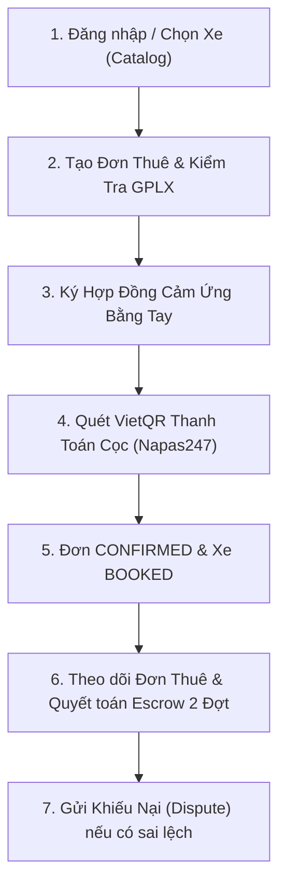

# VELORA Mobile - Customer Car Rental Application

Ứng dụng di động cao cấp dành cho Khách hàng thuê xe tự lái thuộc hệ sinh thái **VELORA**, được phát triển bằng **Flutter 3.47 (Dart 3.13)** và kết nối trực tiếp với Backend **ASP.NET Core (.NET 10)** qua REST API.

---

## 📱 Kiến Trúc Dự Án (Clean Feature-First Architecture)

```
lib/
├── core/
│   ├── constants/
│   │   └── api_constants.dart             # Quản lý Base URL (Localhost, Emulator, Wi-Fi LAN IP) & Endpoints
│   └── theme/
│       └── app_theme.dart                 # Giao diện Modern Dark Material 3 chuẩn thương hiệu VELORA
├── models/
│   ├── car_model.dart                     # Model xe, thông số kỹ thuật, định dạng tiền VNĐ, trạng thái
│   ├── user_model.dart                    # Model tài khoản khách hàng & phân quyền (Role)
│   ├── rental_request_model.dart          # DTO tạo đơn & Model đơn thuê xe tự lái
│   ├── contract_model.dart                # Hợp đồng thuê xe điện tử & trạng thái ký
│   ├── payment_model.dart                 # Giao dịch thanh toán cọc VietQR & Napas247
│   └── settlement_model.dart              # Quyết toán hoàn cọc 2 Đợt (Escrow) & Khiếu nại (Dispute)
├── services/
│   ├── auth_service.dart                  # API đăng nhập JWT, lưu trữ SharedPreferences, hồ sơ
│   ├── car_service.dart                   # API danh mục xe, tìm kiếm & chi tiết phương tiện
│   ├── rental_service.dart                # API tạo đơn thuê, lấy hợp đồng, ký số 2 chiều
│   ├── payment_service.dart               # API sinh mã VietQR cọc & xác nhận thanh toán
│   └── settlement_service.dart            # API xem phiếu quyết toán Escrow & gửi khiếu nại
├── providers/
│   ├── auth_provider.dart                 # State management xác thực & phiên người dùng
│   └── car_provider.dart                  # State management danh mục xe, bộ lọc (Chỗ, Hộp số, Sẵn sàng)
├── screens/
│   ├── splash/
│   │   └── splash_screen.dart             # Splash screen & tự động kiểm tra token JWT
│   ├── auth/
│   │   └── login_screen.dart              # Đăng nhập kèm nút 1-Click điền tài khoản mẫu demo
│   ├── home/
│   │   └── home_screen.dart               # Khám phá xe (Catalog) & Quản lý đơn thuê (My Rentals)
│   ├── car_detail/
│   │   └── car_detail_screen.dart         # Chi tiết xe, thông số kỹ thuật, giá thuê, tiền cọc & chính sách
│   ├── booking/
│   │   └── booking_screen.dart            # Chọn lịch trình, kiểm tra hạng bằng lái GPLX, dự toán chi phí
│   ├── contract/
│   │   └── contract_sign_screen.dart      # Điều khoản hợp đồng & Bảng vẽ chữ ký cảm ứng tay
│   ├── payment/
│   │   └── vietqr_payment_screen.dart     # Mã VietQR động, copy STK 1 chạm & Xác nhận cọc tức thì
│   ├── rentals/
│   │   └── rental_order_detail_screen.dart # Vòng đời đơn thuê, Theo dõi Escrow 2 đợt & Gửi khiếu nại
│   └── profile/
│       └── profile_screen.dart            # Thông tin cá nhân, kiểm tra IP server, Đăng xuất
└── widgets/
    ├── car_card.dart                      # Thẻ xe hiện đại với ảnh, biển số, chip thông số, giá thuê
    ├── signature_pad.dart                 # Bảng vẽ chữ ký cảm ứng thuần Flutter CustomPainter
    └── server_config_dialog.dart          # Hộp thoại chuyển đổi IP Backend linh hoạt trực tiếp trong app
```

---

## 🔄 Trọn Bộ Luồng Nghiệp Vụ Khách Hàng (Customer Rental Journey)



1. **Khám phá & Lọc xe:** Lọc theo 4/5/7 chỗ, số sàn/số tự động, xe sẵn sàng (`READY`), tìm kiếm nhanh.
2. **Tạo đơn thuê:** Chọn ngày giờ bắt đầu/kết thúc (tự động tính số ngày), kiểm tra hạng bằng lái hợp lệ (cảnh báo chặn bằng `B1_AUTO` lái xe số sàn).
3. **Ký hợp đồng số:** Khách hàng dùng ngón tay vẽ chữ ký trực tiếp trên màn hình điện thoại (`SignaturePad`), xác nhận tên người ký.
4. **Thanh toán VietQR:** Sinh mã QR chuyển khoản MBBank tự động kèm đúng số tiền và nội dung `VELORA COC TXN...`, có nút sao chép 1 chạm. Bấm *"Tôi đã chuyển tiền thành công"* để kích hoạt xe sang `BOOKED`.
5. **Quản lý đơn thuê & Escrow 2 đợt:**
   - Bộ lọc trạng thái thông minh: `Tất cả`, `Đã cọc`, `Đang thuê`, `Đối soát Escrow`, `Chờ xử lý`, `Hoàn tất`.
   - Xem chi tiết khấu trừ: Phí trả trễ, phí xăng thiếu, phí vệ sinh 200.000đ, phí hư hại.
   - **Đợt 1:** Hoàn trả tiền cọc thừa ngay sau khi bàn giao xe.
   - **Đợt 2:** Giữ 2.000.000đ đối soát phạt nguội CSGT sau 15–30 ngày.
   - **Khiếu nại trực tuyến (Dispute):** Khách hàng có thể gửi lý do khiếu nại trực tiếp từ app lên Ban Quản Trị VELORA.

---

## 🚀 Hướng Dẫn Khởi Chạy Ứng Dụng

### 1. Khởi động Backend Web API (.NET 10)
```bash
cd "D:\E_Data\Huflit Study\CNPM_NC\Self-Drive-Car-Rental-Management\CarRental.API"
dotnet run
```
*Backend API chạy tại: `http://localhost:5171`*

### 2. Chạy ứng dụng Mobile

#### Cách 1: Chạy trực tiếp trên Google Chrome (Test nhanh)
```bash
cd "D:\E_Data\Huflit Study\CNPM_NC\Self-Drive-Car-Rental-Management\CarRental.Mobile"
flutter run -d chrome
```
*Nhấn `F12` trong Chrome để chuyển sang chế độ màn hình điện thoại di động.*

#### Cách 2: Chạy trên Android Emulator hoặc Điện thoại thật cắm cáp USB
```bash
flutter run
```

---

## 🔑 Tài Khoản Mẫu (1-Click Login)
Tại màn hình Đăng nhập của Mobile, nhấn nút **"Khách hàng (Customer)"** để tự động điền:
- **Email:** `customer@velora.vn`
- **Mật khẩu:** `Velora@2026`
