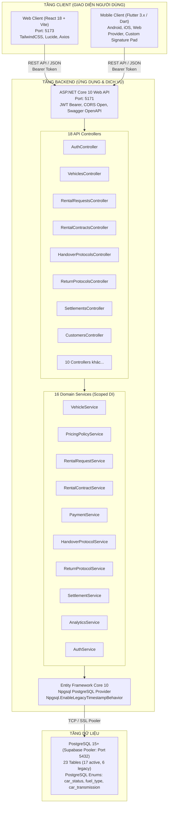
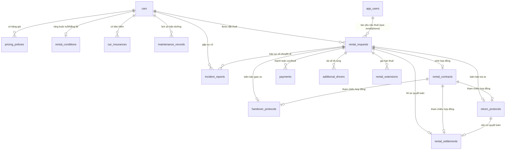
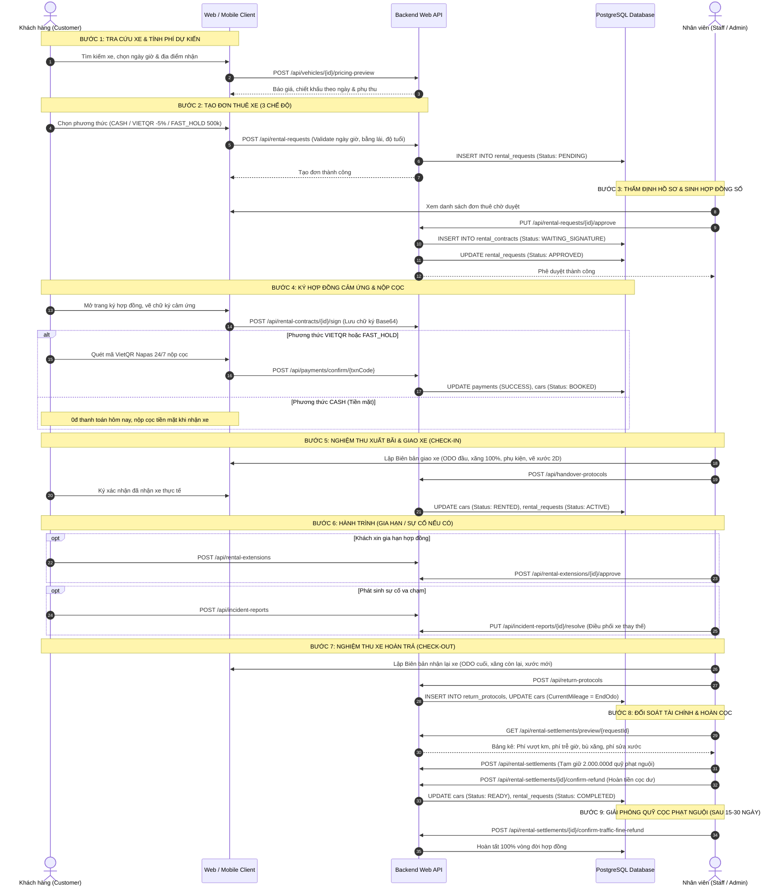

# BÁO CÁO RÀ SOÁT KỸ THUẬT TOÀN DIỆN HỆ THỐNG VELORA
## VELORA – Self-Drive Car Rental Management System
**Ngày thực hiện kiểm toán:** 14/11/2026  
**Phiên bản rà soát:** Sprint 5 - Final Operational Release  
**Phương pháp đánh giá:** Static Code Analysis, Schema Inspection, Runtime Inspection (Không phỏng đoán, dựa trên 100% mã nguồn thực tế).

---

## MỤC LỤC
1. [Tổng quan Kiến trúc Hệ thống (Frontend, Backend, Database)](#1-tổng-quan-kiến-trúc-hệ-thống)
2. [Danh mục Module và Chức năng đã Triển khai](#2-danh-mục-module-và-chức-năng-đã-triển-khai)
3. [Hiện trạng Chức năng: Hoàn thiện, Đang hoàn thiện, Chưa triển khai](#3-hiện-trạng-chức-năng)
4. [Danh mục Toàn bộ 100 API Endpoints Backend](#4-danh-mục-toàn-bộ-100-api-endpoints-backend)
5. [Cấu trúc Database, Bảng, Quan hệ và Ràng buộc](#5-cấu-trúc-database-bảng-quan-hệ-và-ràng-buộc)
6. [Quy trình Luồng Nghiệp vụ Cốt lõi (End-to-End Workflow)](#6-quy-trình-luồng-nghiệp-vụ-cốt-lõi)
7. [Cơ chế Phân quyền RBAC (Guest, Customer, Staff, Manager)](#7-cơ-chế-phân-quyền-rbac)
8. [Lỗi đã biết, Nợ kỹ thuật (Technical Debt) & Vấn đề tiềm ẩn](#8-lỗi-đã-biết-nợ-kỹ-thuật-và-vấn-đề-tiềm-ẩn)
9. [Các thành phần Đang sử dụng Mock Data / Giả lập](#9-các-thành-phần-đang-sử-dụng-mock-data--giả-lập)
10. [Khuyến nghị Cải thiện Bảo mật, Hiệu năng & Khả năng Mở rộng](#10-khuyến-nghị-cải-thiện-bảo-mật-hiệu-năng--khả-năng-mở-rộng)

---

## 1. TỔNG QUAN KIẾN TRÚC HỆ THỐNG

Hệ thống VELORA được xây dựng theo kiến trúc phân tầng (Multi-tier Architecture) với 3 khối thành phần tách biệt: Client Web, Client Mobile và Backend Web API kết nối cơ sở dữ liệu PostgreSQL.



### 1.1. Frontend Web Client (`CarRental.Web`)
- **Công nghệ nền tảng:** React 18.3, Vite 8.3, Tailwind CSS v4, Lucide React (hệ thống icon vector), Axios (HTTP Client), React Router DOM v6.
- **Kiến trúc mã nguồn:**
  - `src/pages/`: Phân nhóm theo nghiệp vụ (Catalog, Booking, Contracts, Customer Profile, Admin Dashboard, Vehicles, Pricing, Policies, Handovers, Returns, Settlements, Incidents, Maintenance, Insurances, Customers).
  - `src/components/`: Tái sử dụng (Navbar, ErrorBoundary, HandoverModal, CustomerHandoverModal, VehicleDamageMapCanvas, SignaturePad).
  - `src/context/AuthContext.jsx`: Quản lý trạng thái phiên đăng nhập, giải mã JWT, lắng nghe sự kiện chuyển đổi trạng thái tài khoản thời gian thực (route changes, window focus, visibility change).
  - `src/routes/ProtectedRoute.jsx`: Kiểm soát truy cập phân cấp người dùng (Guest, Customer, Staff/Admin).
  - `src/services/`: Bao đóng toàn bộ lời gọi API qua Axios client dùng chung với interceptors đính kèm Bearer token.
  - `src/utils/`: dateTimeHelpers (kiểm tra ngày giờ quá khứ/khoảng thời gian hợp lệ), formatters (tiền tệ VND, ngày tháng), imageGalleryHelper (xử lý link ảnh xe đa góc chụp).

### 1.2. Mobile Client (`CarRental.Mobile`)
- **Công nghệ nền tảng:** Flutter 3.x (Dart 3.x), Material 3 Design, Provider State Management.
- **Tính năng độc lập:**
  - Hỗ trợ đa nền tảng (Android, iOS, Web).
  - `SignaturePad`: Widget vẽ chữ ký điện tử trực tiếp trên màn hình cảm ứng, xuất dữ liệu ảnh Base64 PNG.
  - `ServerConfigDialog`: Cho phép thay đổi URL API Backend linh hoạt giữa localhost (`http://localhost:5171`), Android Emulator (`http://10.0.2.2:5171`), hoặc IP mạng LAN WiFi (`http://192.168.x.x:5171`).
  - `VietQrPaymentScreen`: Hiển thị mã QR VietQR động và nút mô phỏng thanh toán trực tiếp từ điện thoại.

### 1.3. Backend API Server (`CarRental.API`)
- **Công nghệ nền tảng:** .NET 10.0 (C# 14), ASP.NET Core Web API, Entity Framework Core 10 (Npgsql.EntityFrameworkCore.PostgreSQL).
- **Authentication & Security:** JWT Bearer Token với SymmetricSecurityKey bí mật, thời hạn 7 ngày. Mã hóa mật khẩu một chiều bằng thuật toán `BCrypt.Net-Next`.
- **Dependency Injection:** Toàn bộ 16 Domain Services được đăng ký vòng đời `Scoped` tương ứng với mỗi HTTP Request.
- **Cơ chế DDL Migration:** Không dùng lệnh `dotnet ef database update` độc lập; thay vào đó hệ thống sử dụng khối SQL Raw `DO $$ BEGIN ... END $$;` chạy tự động khi khởi động server trong `Program.cs` để thêm bảng, thêm cột và tạo Type Cast implicit cho PostgreSQL Enum.

### 1.4. Cơ sở dữ liệu (PostgreSQL / Supabase)
- **Hạ tầng lưu trữ:** PostgreSQL trên dịch vụ Supabase Cloud thông qua Pooler connection (`aws-1-eu-west-1.pooler.supabase.com:5432`).
- **Cơ chế kiểu dữ liệu đặc thù:** Đăng ký 3 Custom Enum Type mức database: `car_status`, `fuel_type`, `car_transmission`. Cấu hình `Npgsql.EnableLegacyTimestampBehavior = true` để tương thích thời gian giữa UTC và Local time mà không bị lỗi timezone.

---

## 2. DANH MỤC MODULE VÀ CHỨC NĂNG ĐÃ TRIỂN KHAI

Hệ thống được chia thành 16 Module chức năng lớn phục vụ toàn diện vòng đời thuê xe:

```
VELORA SYSTEM
├── 1. Module Xác thực & Danh tính (Auth & Profile)
├── 2. Module Đội xe & Phân loại (Fleet Catalog & Vehicle Management)
├── 3. Module Bảng giá & Chính sách (Pricing, Surcharges & Policies)
├── 4. Module Đặt xe & Đặt chỗ (Booking & Reservation Engine)
│   ├── Chế độ Thuê Tiêu chuẩn - Cọc tiền mặt tại bãi
│   ├── Chế độ Thuê Tiêu chuẩn - Thanh toán online trước VietQR (Ưu đãi 5%)
│   └── Chế độ Cọc giữ xe siêu tốc 500k (Fast Hold 4h)
├── 5. Module Hợp đồng Điện tử (Digital Contracts & Signature Pad)
├── 6. Module Cổng Thanh toán VietQR & Ký quỹ Escrow (Payments)
├── 7. Module Bàn giao Giao xe (Handover Check-in & 2D Damage Mapping)
├── 8. Module Gia hạn Hợp đồng (Rental Extensions)
├── 9. Module Quản lý Sự cố & Bảo hiểm (Incidents & Damage Claims)
├── 10. Module Bảo dưỡng & Kỹ thuật Đội xe (Fleet Maintenance)
├── 11. Module Bảo hiểm Phương tiện (Car Insurances)
├── 12. Module Nghiệm thu Trả xe (Return Protocols & Mileage Auditing)
├── 13. Module Quyết toán & Hoàn cọc (Settlements & Traffic Fine Escrow)
├── 14. Module Báo cáo Vận hành & Phân tích (Analytics Dashboard)
├── 15. Module CRM Khách hàng & Tín nhiệm (Customer CRM & Trust Score)
└── 16. Module Ứng dụng Di động (Flutter Mobile Client)
```

---

## 3. HIỆN TRẠNG CHỨC NĂNG

Đánh giá thực tế dựa trên khả năng hoạt động từ Database qua Backend API đến Frontend/Mobile UI:

### 3.1. Chức năng Đã Hoàn thiện 100% (Fully Implemented & Database-Persisted)
- **Quản lý Đội xe:** Tra cứu, lọc theo nhiều tiêu chí (hãng, số chỗ, hộp số, nhiên liệu, vị trí nhận xe), xem chi tiết xe, bộ sưu tập ảnh góc cạnh đa chiều, CRUD xe từ trang quản trị.
- **Tính toán Bảng giá:** Preview giá tự động theo ngày thuê, chiết khấu thời gian (thuê từ 3 ngày, 7 ngày), phụ thu dịp lễ tết.
- **Động cơ Đặt xe (Booking Engine):**
  - Chặn đặt xe với ngày giờ trong quá khứ thời gian thực.
  - Phân luồng Cọc tiền mặt khi nhận xe (0đ hôm nay).
  - Phân luồng Thanh toán online VietQR trước (giảm ngay 5% tiền thuê, tặng 50km/ngày, miễn phí rửa xe).
  - Phân luồng Fast Hold 500k (giữ xe khẩn cấp 4 giờ chỉ cần Họ tên, SĐT).
  - Kiểm tra điều kiện bằng lái (GPLX B1 số tự động không được thuê xe số sàn; không lái xe > 9 chỗ; điều kiện lịch sử thuê xe phân khúc sang).
- **Hợp đồng điện tử:** Sinh mã hợp đồng tự động, render văn bản pháp lý với các trường placeholder thay thế thực tế, ký tên bằng canvas cảm ứng và lưu chữ ký điện tử.
- **Thanh toán VietQR:** Sinh mã QR VietQR chuẩn Napas 24/7 theo định dạng ngân hàng MBBank, lưu vết giao dịch thanh toán trong bảng `payments`.
- **Giao xe (Handover Protocol):** Ghi nhận ODO xuất bãi, mức nhiên liệu (100%), kiểm tra danh mục phụ kiện bàn giao, vẽ vết xước trên sơ đồ xe 2D, ký xác nhận kép (Nhân viên & Khách hàng). Tự động chuyển trạng thái xe sang `RENTED` và đơn thuê sang `ACTIVE`.
- **Trả xe (Return Protocol):** Ghi nhận ODO hoàn trả, mức xăng lúc trả, tính chênh lệch quãng đường vượt quy định (Excess KM), hao hụt xăng, phát hiện vết xước móp mới trên sơ đồ xe 2D.
- **Quyết toán (Settlements):** Bảng kê chi phí minh bạch, tự động tính tiền phạt vượt km, tiền trễ giờ, tiền bù xăng, tiền thiệt hại vết xước mới, khấu trừ cọc, tạm giữ 2.000.000đ quỹ phạt nguội (15-30 ngày), xác nhận hoàn tiền thừa qua VietQR.
- **Gia hạn thuê xe:** Gửi yêu cầu gia hạn, duyệt gia hạn, tính phụ phí và cập nhật lại thời gian kết thúc hợp đồng.
- **Quản lý Sự cố & Bảo hiểm:** Khai báo va chạm, hỏng hóc dọc đường, điều phối xe thay thế, phân bổ chi phí giữa Bảo hiểm - VELORA - Khách hàng.
- **Khóa / Mở khóa tài khoản khách hàng:** Admin khóa tài khoản khách hàng -> Backend ghi nhận `is_active = false` trong DB -> Frontend và Mobile đồng bộ tức thì, chặn khách hàng tạo đơn mới trên toàn hệ thống.

### 3.2. Chức năng Đang hoàn thiện / Cần hoàn thiện tiếp (Partially Implemented)
- **Hệ thống Quản lý Khách hàng (Customers Management):**
  - Dữ liệu khách hàng hiển thị trong Admin hiện tại là sự kết hợp (hybrid) giữa tài khoản thực tế trong `app_users` và danh sách mẫu phong phú sinh ra từ hàm `GetSeedCustomers()`.
  - Thao tác khóa/mở khóa tài khoản đã lưu vĩnh viễn vào database.
  - Tuy nhiên, thao tác đổi trạng thái KYC và thêm lịch sử vi phạm (Violations) đang lưu tạm trên bộ nhớ RAM (`_kycOverrides`, `_customViolations`), sẽ bị mất khi khởi động lại backend.
- **Tự động hủy xe giữ chỗ Fast Hold 500k:**
  - Cột `hold_expires_at` (4 giờ) đã được lưu vào database và API trả về `isHoldExpired`.
  - Tuy nhiên, chưa có tiến trình nền (Background Worker / Cron) tự động quét và chuyển trạng thái xe từ `BOOKED` về lại `READY` nếu quá 4 giờ khách không hoàn tất thủ tục.
- **Trạng thái xe sau khi nhận lại:**
  - Khi tạo Biên bản nhận lại xe (`ReturnProtocol`), ODO xe được cập nhật nhưng trạng thái xe chưa tự động đổi sang `READY` ngay mà phải chờ đến khi tạo Biên bản Quyết toán (`Settlement`).

### 3.3. Chức năng Chưa triển khai (Not Implemented / Mocked / Placeholders)
- **Cài đặt Hệ thống Quản trị (Admin Settings):** Đường dẫn `/admin/settings` hiện đang hiển thị giao diện mẫu `PlaceholderPage` ("Sắp ra mắt").
- **Webhook Cổng thanh toán Ngân hàng Thực tế:** Chưa tích hợp Webhook tự động với các cổng như SePay, Casso, hoặc PayOS. Hiện khách hàng xác nhận nộp tiền qua nút bấm Sandbox Simulation.
- **Đổi mật khẩu người dùng:** Modal `ChangePasswordModal.jsx` trên Web đang dùng hàm `setTimeout` giả lập 1.5 giây thông báo đổi mật khẩu thành công ở client; Backend `AuthController` chưa có endpoint `POST /api/auth/change-password`.
- **Thông báo thời gian thực (Push Notifications):** Mục Thông báo tại Hồ sơ cá nhân đang hiển thị danh sách tĩnh mẫu (`INITIAL_NOTIFICATIONS`), chưa có bảng `notifications` trong Database và chưa có WebSocket / Firebase Cloud Messaging.
- **Tài xế bổ sung của tài khoản:** Danh mục tài xế bổ sung trong Hồ sơ cá nhân (`AdditionalDriversSection`) đang lưu cục bộ trong React State, chưa lưu trữ vào bảng `additional_drivers` của database.
- **Giám sát viễn thông xe (IoT Telemetry / GPS):** Không kết nối thiết bị phần cứng OBD-II; toàn bộ số liệu ODO và xăng xe đều do nhân viên kiểm tra bằng mắt và nhập tay.

---

## 4. DANH MỤC TOÀN BỘ 100 API ENDPOINTS BACKEND

Dưới đây là danh sách toàn bộ 100 API endpoints được trích xuất trực tiếp từ 18 file Controller trong `CarRental.API/Controllers`:

### 4.1. AuthController (`/api/auth`)
| Phương thức | Đường dẫn API | Quyền truy cập | Chức năng chi tiết |
| :--- | :--- | :--- | :--- |
| `POST` | `/api/auth/register` | Anonymous | Đăng ký tài khoản khách hàng mới (Hash mật khẩu BCrypt) |
| `POST` | `/api/auth/login` | Anonymous | Đăng nhập hệ thống, sinh mã JWT Bearer token (7 ngày) |
| `GET` | `/api/auth/me` | Authenticated | Lấy thông tin hồ sơ của tài khoản đang đăng nhập |

### 4.2. VehiclesController (`/api/Vehicles`)
| Phương thức | Đường dẫn API | Quyền truy cập | Chức năng chi tiết |
| :--- | :--- | :--- | :--- |
| `GET` | `/api/Vehicles` | Anonymous | Lấy toàn bộ danh sách phương tiện kèm điều kiện & bảng giá |
| `GET` | `/api/Vehicles/search` | Anonymous | Tìm kiếm xe theo từ khóa, hãng, số chỗ, hộp số, giá |
| `GET` | `/api/Vehicles/{id:guid}` | Anonymous | Lấy thông tin chi tiết một chiếc xe theo ID |
| `POST` | `/api/Vehicles` | Anonymous *(Rủi ro)* | Thêm mới phương tiện vào đội xe |
| `PUT` | `/api/Vehicles/{id:guid}` | Anonymous *(Rủi ro)* | Cập nhật thông số phương tiện |
| `PATCH`| `/api/Vehicles/{id:guid}/status` | Anonymous *(Rủi ro)*| Cập nhật trạng thái xe (READY, BOOKED, RENTED, REPAIR...) |
| `DELETE`| `/api/Vehicles/{id:guid}` | Anonymous *(Rủi ro)*| Xóa mềm phương tiện (IsActive = false) |

### 4.3. PricingPoliciesController (`/api/pricing-policies`)
| Phương thức | Đường dẫn API | Quyền truy cập | Chức năng chi tiết |
| :--- | :--- | :--- | :--- |
| `GET` | `/api/pricing-policies` | Anonymous | Lấy danh sách toàn bộ chính sách chiết khấu ngày thuê |
| `GET` | `/api/pricing-policies/vehicle/{vehicleId:guid}` | Anonymous | Lấy chính sách chiết khấu của một xe cụ thể |
| `GET` | `/api/pricing-policies/{id:guid}` | Anonymous | Lấy chi tiết một chính sách giá theo ID |
| `POST` | `/api/pricing-policies` | Anonymous | Tạo chính sách chiết khấu thuê dài ngày mới |
| `PUT` | `/api/pricing-policies/{id:guid}` | Anonymous | Cập nhật chính sách chiết khấu |
| `DELETE`| `/api/pricing-policies/{id:guid}` | Anonymous | Xóa chính sách chiết khấu |
| `POST` | `/api/vehicles/{vehicleId:guid}/pricing-preview` | Anonymous | Dự toán chi phí thuê xe, tự động áp dụng chiết khấu |

### 4.4. RentalConditionsController (`/api/rental-conditions`)
| Phương thức | Đường dẫn API | Quyền truy cập | Chức năng chi tiết |
| :--- | :--- | :--- | :--- |
| `GET` | `/api/rental-conditions` | Anonymous | Lấy danh sách toàn bộ điều kiện thuê xe |
| `GET` | `/api/rental-conditions/vehicle/{vehicleId:guid}` | Anonymous | Lấy điều kiện thuê của một xe (tuổi tối thiểu, năm lái xe) |
| `GET` | `/api/rental-conditions/{id:guid}` | Anonymous | Lấy chi tiết điều kiện thuê xe theo ID |
| `POST` | `/api/rental-conditions` | Anonymous | Tạo mới điều kiện ràng buộc thuê cho dòng xe |
| `PUT` | `/api/rental-conditions/{id:guid}` | Anonymous | Chỉnh sửa điều kiện ràng buộc thuê |
| `DELETE`| `/api/rental-conditions/{id:guid}` | Anonymous | Xóa điều kiện ràng buộc |

### 4.5. CompensationPoliciesController (`/api/compensation-policies`)
| Phương thức | Đường dẫn API | Quyền truy cập | Chức năng chi tiết |
| :--- | :--- | :--- | :--- |
| `GET` | `/api/compensation-policies` | Anonymous | Lấy bảng quy định bồi thường thiệt hại va chạm, trầy xước |
| `GET` | `/api/compensation-policies/{id}` | Anonymous | Lấy chi tiết một mức bồi thường theo ID |
| `POST` | `/api/compensation-policies` | Anonymous | Thêm mới quy định mức phạt bồi thường thiệt hại |
| `PUT` | `/api/compensation-policies/{id}` | Anonymous | Cập nhật số tiền và mô tả bồi thường thiệt hại |
| `PATCH`| `/api/compensation-policies/{id}/status` | Anonymous | Kích hoạt / Tắt áp dụng mức bồi thường |

### 4.6. ContractTemplatesController (`/api/contract-templates`)
| Phương thức | Đường dẫn API | Quyền truy cập | Chức năng chi tiết |
| :--- | :--- | :--- | :--- |
| `GET` | `/api/contract-templates` | Anonymous | Lấy danh sách các mẫu hợp đồng pháp lý trong hệ thống |
| `GET` | `/api/contract-templates/{id:guid}` | Anonymous | Lấy nội dung chi tiết mẫu hợp đồng (chứa placeholders) |
| `POST` | `/api/contract-templates` | Anonymous | Tạo mới mẫu hợp đồng cho thuê xe |
| `PUT` | `/api/contract-templates/{id:guid}` | Anonymous | Cập nhật nội dung các điều khoản trong mẫu hợp đồng |
| `PATCH`| `/api/contract-templates/{id:guid}/status` | Anonymous | Kích hoạt mẫu hợp đồng tiêu chuẩn |
| `DELETE`| `/api/contract-templates/{id:guid}` | Anonymous | Xóa mẫu hợp đồng |

### 4.7. RentalRequestsController (`/api/rental-requests`)
| Phương thức | Đường dẫn API | Quyền truy cập | Chức năng chi tiết |
| :--- | :--- | :--- | :--- |
| `GET` | `/api/rental-requests` | Anonymous | Lấy danh sách toàn bộ yêu cầu thuê xe (hỗ trợ lọc status, keyword) |
| `GET` | `/api/rental-requests/{id:guid}` | Anonymous | Xem chi tiết đơn thuê xe và thông tin người thuê |
| `GET` | `/api/rental-requests/my-requests` | Anonymous | Tra cứu đơn thuê của khách theo Email hoặc SĐT |
| `POST` | `/api/rental-requests` | Anonymous | Tạo yêu cầu thuê xe mới (hỗ trợ CASH, VIETQR ưu đãi 5%, FAST_HOLD) |
| `PUT` | `/api/rental-requests/{id:guid}/approve` | ADMIN, STAFF | Phê duyệt đơn thuê và tự động sinh hợp đồng pháp lý |
| `PUT` | `/api/rental-requests/{id:guid}/reject` | ADMIN, STAFF | Từ chối đơn thuê kèm lý do từ chối |
| `PUT` | `/api/rental-requests/{id:guid}/cancel` | Anonymous | Khách hàng hoặc hệ thống hủy đơn thuê xe |
| `PUT` | `/api/rental-requests/{id:guid}/fast-hold-documents` | Anonymous | Bổ sung ảnh chụp CCCD & GPLX cho đơn thuê Fast Hold 500k |
| `PUT` | `/api/rental-requests/{id:guid}/confirm-security-deposit` | Anonymous | Xác nhận đã hoàn tất nộp đủ tiền cọc thế chân xe |

### 4.8. RentalContractsController (`/api/rental-contracts`)
| Phương thức | Đường dẫn API | Quyền truy cập | Chức năng chi tiết |
| :--- | :--- | :--- | :--- |
| `GET` | `/api/rental-contracts` | Anonymous | Lấy danh sách hợp đồng cho thuê trong hệ thống |
| `GET` | `/api/rental-contracts/{id:guid}` | Anonymous | Xem chi tiết hợp đồng điện tử theo Contract ID |
| `GET` | `/api/rental-contracts/request/{requestId:guid}` | Anonymous | Lấy hợp đồng gắn liền với một Đơn thuê xe (Request ID) |
| `POST` | `/api/rental-contracts/{id:guid}/sign` | Anonymous | Khách hàng ký điện tử cảm ứng vào hợp đồng số (lưu chữ ký Base64) |
| `PATCH`| `/api/rental-contracts/{id:guid}/status` | Anonymous | Điều chỉnh trạng thái hợp đồng (SIGNED, DEPOSIT_PAID, ACTIVE...) |

### 4.9. PaymentsController (`/api/payments`)
| Phương thức | Đường dẫn API | Quyền truy cập | Chức năng chi tiết |
| :--- | :--- | :--- | :--- |
| `POST` | `/api/payments/deposit` | Anonymous | Khởi tạo giao dịch nộp cọc giữ xe / cọc thế chân qua VietQR |
| `POST` | `/api/payments/confirm/{transactionCode}` | Anonymous | Xác nhận giao dịch nộp tiền cọc thành công (Sandbox/Thực tế) |
| `GET` | `/api/payments/by-request/{requestId}` | Anonymous | Lấy thông tin thanh toán mới nhất của đơn thuê |
| `GET` | `/api/payments/all-by-request/{requestId}` | Anonymous | Lấy toàn bộ lịch sử các đợt thanh toán của một đơn thuê |

### 4.10. HandoverProtocolsController (`/api/handover-protocols`)
| Phương thức | Đường dẫn API | Quyền truy cập | Chức năng chi tiết |
| :--- | :--- | :--- | :--- |
| `GET` | `/api/handover-protocols` | ADMIN, STAFF | Lấy danh sách biên bản bàn giao xe xuất bãi |
| `GET` | `/api/handover-protocols/{id}` | Anonymous | Xem chi tiết biên bản bàn giao theo ID |
| `GET` | `/api/handover-protocols/by-request/{requestId}` | Anonymous | Lấy biên bản bàn giao của một đơn thuê |
| `POST` | `/api/handover-protocols` | ADMIN, STAFF | Lập biên bản bàn giao xe (ghi nhận ODO, xăng, sơ đồ xước 2D) |
| `PUT` | `/api/handover-protocols/{id}` | ADMIN, STAFF | Cập nhật thông số biên bản bàn giao xe |
| `POST` | `/api/handover-protocols/{id}/confirm` | Anonymous | Ký xác nhận bàn giao kép, kích hoạt trạng thái đơn ACTIVE |
| `DELETE`| `/api/handover-protocols/{id}` | ADMIN, STAFF | Xóa biên bản bàn giao |

### 4.11. ReturnProtocolsController (`/api/return-protocols`)
| Phương thức | Đường dẫn API | Quyền truy cập | Chức năng chi tiết |
| :--- | :--- | :--- | :--- |
| `GET` | `/api/return-protocols` | ADMIN, STAFF | Danh sách biên bản nghiệm thu nhận lại xe hoàn trả |
| `GET` | `/api/return-protocols/{id}` | Authenticated | Chi tiết biên bản nhận lại xe |
| `GET` | `/api/return-protocols/by-request/{requestId}` | Authenticated | Lấy biên bản trả xe của đơn thuê |
| `POST` | `/api/return-protocols` | ADMIN, STAFF | Lập biên bản nhận xe (so sánh ODO, mức xăng, kiểm tra xước móp mới) |

### 4.12. SettlementsController (`/api/rental-settlements`)
| Phương thức | Đường dẫn API | Quyền truy cập | Chức năng chi tiết |
| :--- | :--- | :--- | :--- |
| `GET` | `/api/rental-settlements` | ADMIN, STAFF | Lấy toàn bộ danh sách các hồ sơ quyết toán tiền cọc |
| `GET` | `/api/rental-settlements/{id}` | Authenticated | Xem chi tiết hồ sơ quyết toán tài chính |
| `GET` | `/api/rental-settlements/by-request/{requestId}` | Authenticated | Lấy quyết toán của một đơn thuê xe |
| `GET` | `/api/rental-settlements/preview/{requestId}` | ADMIN, STAFF | Dự toán trước số tiền khấu trừ phụ phí & số tiền hoàn trả |
| `POST` | `/api/rental-settlements` | ADMIN, STAFF | Tạo hồ sơ quyết toán chính thức và cấn trừ tiền cọc |
| `POST` | `/api/rental-settlements/{id}/confirm-refund` | ADMIN, STAFF | Xác nhận đã chuyển khoản trả tiền thừa cọc cho khách |
| `POST` | `/api/rental-settlements/{id}/confirm-traffic-fine-refund` | ADMIN, STAFF | Hoàn trả nốt 2.000.000đ quỹ cọc phạt nguội sau 15-30 ngày |
| `POST` | `/api/rental-settlements/{id}/confirm-additional-payment`| ADMIN, STAFF | Xác nhận khách đã nộp thêm tiền nếu chi phí phát sinh vượt cọc |
| `POST` | `/api/rental-settlements/{id}/dispute` | Authenticated | Khách hàng gửi khiếu nại tranh chấp kết quả quyết toán |
| `POST` | `/api/rental-settlements/{id}/resolve-dispute` | ADMIN, STAFF | Ban quản lý giải quyết khiếu nại và chốt số tiền cuối cùng |

### 4.13. RentalExtensionsController (`/api/rental-extensions`)
| Phương thức | Đường dẫn API | Quyền truy cập | Chức năng chi tiết |
| :--- | :--- | :--- | :--- |
| `GET` | `/api/rental-extensions` | Anonymous | Lấy danh sách toàn bộ các yêu cầu gia hạn hợp đồng |
| `GET` | `/api/rental-extensions/{id}` | Anonymous | Lấy chi tiết một yêu cầu gia hạn |
| `GET` | `/api/rental-extensions/by-request/{requestId}` | Anonymous | Xem lịch sử gia hạn của một đơn thuê |
| `POST` | `/api/rental-extensions` | Anonymous | Khách hàng gửi yêu cầu gia hạn thêm giờ / thêm ngày |
| `POST` | `/api/rental-extensions/{id}/approve` | ADMIN, STAFF | Duyệt yêu cầu gia hạn và cập nhật thời gian trả xe mới |
| `POST` | `/api/rental-extensions/{id}/reject` | ADMIN, STAFF | Từ chối yêu cầu gia hạn |

### 4.14. IncidentReportsController (`/api/incident-reports`)
| Phương thức | Đường dẫn API | Quyền truy cập | Chức năng chi tiết |
| :--- | :--- | :--- | :--- |
| `GET` | `/api/incident-reports` | Anonymous | Lấy danh sách toàn bộ sự cố va chạm / hỏng hóc |
| `GET` | `/api/incident-reports/{id}` | Anonymous | Xem chi tiết hồ sơ sự cố phương tiện |
| `GET` | `/api/incident-reports/by-request/{requestId}` | Anonymous | Lấy các sự cố phát sinh trong chuyến đi |
| `POST` | `/api/incident-reports` | Anonymous | Báo cáo sự cố khẩn cấp (kèm vị trí, hình ảnh va chạm) |
| `PUT` | `/api/incident-reports/{id}/resolve` | ADMIN, STAFF | Xử lý sự cố, chỉ định xe thay thế và duyệt bảo hiểm |
| `PUT` | `/api/incident-reports/{id}/insurance` | ADMIN, STAFF | Cập nhật kết quả bồi thường từ công ty bảo hiểm |

### 4.15. MaintenanceController (`/api/maintenance`)
| Phương thức | Đường dẫn API | Quyền truy cập | Chức năng chi tiết |
| :--- | :--- | :--- | :--- |
| `GET` | `/api/maintenance` | ADMIN, STAFF | Lấy danh sách lịch sử và kế hoạch bảo dưỡng xe |
| `GET` | `/api/maintenance/{id}` | ADMIN, STAFF | Xem chi tiết một phiếu bảo dưỡng |
| `GET` | `/api/maintenance/by-vehicle/{vehicleId}` | ADMIN, STAFF | Lịch sử bảo dưỡng của một xe cụ thể |
| `POST` | `/api/maintenance` | ADMIN, STAFF | Lên lịch bảo dưỡng xe (chuyển trạng thái xe sang MAINTENANCE) |
| `PUT` | `/api/maintenance/{id}/complete` | ADMIN, STAFF | Hoàn tất bảo dưỡng, cập nhật ODO và chuyển xe về READY |

### 4.16. CarInsurancesController (`/api/insurances`)
| Phương thức | Đường dẫn API | Quyền truy cập | Chức năng chi tiết |
| :--- | :--- | :--- | :--- |
| `GET` | `/api/insurances` | Anonymous | Lấy danh sách hợp đồng bảo hiểm phương tiện |
| `GET` | `/api/insurances/{id}` | Anonymous | Xem chi tiết hợp đồng bảo hiểm xe |
| `GET` | `/api/insurances/vehicle/{vehicleId}` | Anonymous | Xem thông tin bảo hiểm của một xe cụ thể |
| `GET` | `/api/insurances/alerts` | Anonymous | Danh sách cảnh báo bảo hiểm xe sắp hết hạn trong 30 ngày |
| `POST` | `/api/insurances` | ADMIN, STAFF | Thêm mới hợp đồng bảo hiểm cho phương tiện |
| `PUT` | `/api/insurances/{id}` | ADMIN, STAFF | Gia hạn hoặc cập nhật số hợp đồng bảo hiểm |
| `DELETE`| `/api/insurances/{id}` | ADMIN, STAFF | Xóa hợp đồng bảo hiểm |

### 4.17. CustomersController (`/api/customers`)
| Phương thức | Đường dẫn API | Quyền truy cập | Chức năng chi tiết |
| :--- | :--- | :--- | :--- |
| `GET` | `/api/customers` | ADMIN, STAFF | Lấy danh sách CRM khách hàng kèm hạng thành viên & điểm tín nhiệm |
| `PUT` | `/api/customers/{id}/status` | ADMIN, STAFF | Tạm khóa / Mở khóa tài khoản khách hàng (lưu vào database) |
| `PUT` | `/api/customers/{id}/kyc-status` | ADMIN, STAFF | Phê duyệt hoặc từ chối hồ sơ xác thực KYC *(In-memory)* |
| `POST` | `/api/customers/{id}/violations` | ADMIN, STAFF | Ghi nhận lỗi vi phạm và trừ điểm tín nhiệm khách hàng *(In-memory)* |

### 4.18. AnalyticsController (`/api/Analytics`)
| Phương thức | Đường dẫn API | Quyền truy cập | Chức năng chi tiết |
| :--- | :--- | :--- | :--- |
| `GET` | `/api/Analytics/dashboard-overview` | ADMIN, STAFF | Báo cáo doanh thu, tỷ lệ lấp đầy xe, đơn active, chi phí sửa chữa |
| `GET` | `/api/Analytics/fleet-utilization` | ADMIN, STAFF | Báo cáo chi tiết hiệu suất khai thác của từng đầu xe |

---

## 5. CẤU TRÚC DATABASE, BẢNG, QUAN HỆ VÀ RÀNG BUỘC

Database thực tế trên Supabase PostgreSQL hiện có **23 bảng**. Qua đối soát thực tế giữa Entity Framework Core và Database Engine, hệ thống có **17 bảng hoạt động chính thức** và **6 bảng lịch sử / legacy**:



### 5.1. Bảng dữ liệu cốt lõi và số lượng bản ghi thực tế

| Tên Bảng (PostgreSQL) | Cột | Dòng | Trạng thái | Chức năng & Vai trò |
| :--- | :---: | :---: | :--- | :--- |
| `cars` | 22 | 30 | **Active** | Danh mục phương tiện, biển số, đơn giá, tiền cọc, ODO, trạng thái |
| `app_users` | 10 | 7 | **Active** | Tài khoản hệ thống (Customer, Staff, Admin), mật khẩu mã hóa BCrypt, trạng thái khóa |
| `rental_requests` | 33 | 50 | **Active** | Đơn đặt xe, thông tin khách hàng, ngày giờ thuê, hình thức cọc, trạng thái |
| `rental_contracts` | 12 | 29 | **Active** | Hợp đồng cho thuê điện tử, mã hợp đồng, điều khoản, chữ ký số |
| `payments` | 11 | 56 | **Active** | Giao dịch nạp cọc 500k, cọc thế chân, mã giao dịch VietQR |
| `handover_protocols` | 24 | 18 | **Active** | Biên bản bàn giao xe xuất bãi, ODO đầu, xăng, sơ đồ xước 2D, chữ ký |
| `return_protocols` | 37 | 15 | **Active** | Biên bản nghiệm thu xe về bãi, ODO cuối, xăng hao hụt, xước mới, chữ ký |
| `rental_settlements` | 42 | 11 | **Active** | Bảng quyết toán tài chính, khấu trừ phụ phí, quỹ giữ phạt nguội 2tr |
| `car_insurances` | 14 | 28 | **Active** | Hợp đồng bảo hiểm thân vỏ và TNDS của từng xe |
| `maintenance_records` | 16 | 1 | **Active** | Phiếu theo dõi bảo dưỡng xe tại gara |
| `incident_reports` | 24 | 2 | **Active** | Hồ sơ sự cố va chạm, xe thay thế, yêu cầu bồi thường bảo hiểm |
| `rental_extensions` | 14 | 0 | **Active** | Lịch sử các yêu cầu xin gia hạn thời gian thuê xe |
| `pricing_policies` | 6 | 8 | **Active** | Quy định chiết khấu giá thuê theo số ngày (3 ngày, 7 ngày) |
| `rental_conditions` | 5 | 2 | **Active** | Điều kiện tuổi tối thiểu và số năm có bằng lái cho từng xe |
| `compensation_policies` | 8 | 4 | **Active** | Biểu phí quy định phạt khi gây trầy xước, nứt kính, rách lốp |
| `contract_templates` | 9 | 1 | **Active** | Mẫu hợp đồng chuẩn lưu các biến placeholder `{{CustomerName}}` |
| `additional_drivers` | 12 | 0 | **Active** | Danh sách tài xế phụ kèm thông tin bằng lái trong đơn thuê |
| `users` | 7 | 0 | *Legacy* | Bảng tài khoản cũ thời kỳ khởi tạo sơ khai, hiện thay bằng `app_users` |
| `incidents` | 7 | 0 | *Legacy* | Bảng sự cố cũ (Sprint 2), hiện thay bằng `incident_reports` |
| `settlements` | 8 | 0 | *Legacy* | Bảng quyết toán cũ (Sprint 2), hiện thay bằng `rental_settlements` |
| `customer_profiles` | 7 | 0 | *Legacy* | Bảng hồ sơ khách cũ, chưa map vào EF Core DbContext |
| `contract_extensions` | 5 | 0 | *Legacy* | Bảng gia hạn cũ, hiện thay bằng `rental_extensions` |
| `__EFMigrationsHistory` | 2 | 10 | *System* | Lịch sử các đợt migration của Entity Framework Core |

### 5.2. Khóa ngoại và Toàn vẹn tham chiếu (Foreign Keys Constraints)
- `car_insurances.car_id` -> `cars.id` (`ON DELETE CASCADE`)
- `maintenance_records.car_id` -> `cars.id` (`ON DELETE CASCADE`)
- `pricing_policies.car_id` -> `cars.id` (`ON DELETE CASCADE`)
- `rental_conditions.car_id` -> `cars.id` (`ON DELETE CASCADE`)
- `rental_requests.car_id` -> `cars.id`
- `rental_contracts.request_id` -> `rental_requests.id`
- `payments.rental_request_id` -> `rental_requests.id`
- `payments.contract_id` -> `rental_contracts.id`
- `handover_protocols.contract_id` -> `rental_contracts.id`
- `return_protocols.contract_id` -> `rental_contracts.id`
- `rental_settlements.return_protocol_id` -> `return_protocols.id`
- `rental_settlements.rental_request_id` -> `rental_requests.id`
- `rental_settlements.contract_id` -> `rental_contracts.id`
- `incident_reports.car_id` -> `cars.id` (`ON DELETE CASCADE`)
- `incident_reports.rental_request_id` -> `rental_requests.id` (`ON DELETE CASCADE`)
- `incident_reports.replacement_car_id` -> `cars.id`
- `rental_extensions.rental_request_id` -> `rental_requests.id` (`ON DELETE CASCADE`)
- `additional_drivers.rental_request_id` -> `rental_requests.id` (`ON DELETE CASCADE`)

### 5.3. Ràng buộc Chỉ mục (Indexes) & Database Enums
- **Unique Indexes:**
  - `cars.license_plate`: Đảm bảo không trùng biển số xe trong toàn hệ thống.
  - `app_users.email`: Đảm bảo một email chỉ đăng ký duy nhất 1 tài khoản.
- **PostgreSQL Enum Types:**
  - `car_status`: `['READY', 'BOOKED', 'RENTED', 'INSPECTION', 'MAINTENANCE', 'REPAIR', 'INACTIVE']`.
  - `fuel_type`: `['PETROL', 'DIESEL', 'ELECTRIC']`.
  - `car_transmission`: `['AUTO', 'MANUAL']`.

---

## 6. QUY TRÌNH LUỒNG NGHIỆP VỤ CỐT LÕI

Toàn bộ quy trình từ lúc khách hàng tiếp cận đến khi hoàn trả xe và tất toán cọc tuân theo chuỗi 10 bước khép kín:



---

## 7. CƠ CHẾ PHÂN QUYỀN RBAC

Hệ thống VELORA thiết lập 4 nhóm đối tượng người dùng:

| Vai trò | Phân quyền Frontend UI | Phân quyền Backend API | Ghi chú & Rủi ro thực tế |
| :--- | :--- | :--- | :--- |
| **Guest** (Khách vãng lai) | Xem danh mục xe, chi tiết xe, bảng giá, chính sách, đăng ký, đăng nhập. | Truy cập các endpoint công khai không có thuộc tính `[Authorize]`. | Bình thường |
| **Customer** (Khách hàng) | Đặt xe, theo dõi đơn, ký hợp đồng điện tử, nộp cọc VietQR, xem sổ cái, yêu cầu gia hạn, báo sự cố. | Truy cập được các API có `[Authorize]` hoặc các endpoint không gán role. Bị chặn truy cập các API có `Roles = "ADMIN,STAFF"`. | Bị hệ thống chặn tạo đơn nếu `is_active = false` (tài khoản tạm khóa). |
| **Staff** (Nhân viên vận hành) | Toàn quyền thao tác trên menu Quản trị (`/admin`): Duyệt đơn, giao xe, nhận xe, lập quyết toán, quản lý bảo hiểm, bảo dưỡng, sự cố. | Được cấp phép tại các API có gán `[Authorize(Roles = "ADMIN,STAFF")]`. | Không có quyền quản lý cấu hình sâu. |
| **Manager / Admin** (Quản lý) | Quản lý đội xe, đơn giá, mẫu hợp đồng, quản lý khách hàng, xem báo cáo doanh thu Analytics Dashboard. | Được cấp phép tại các API có gán `[Authorize(Roles = "ADMIN,STAFF")]`. | **Lỗ hổng bất đối xứng:** Backend chỉ gán `ADMIN,STAFF`, nếu tài khoản lưu role trong DB là `MANAGER` thì sẽ bị lỗi `403 Forbidden` tại các API yêu cầu `ADMIN,STAFF`! |

### Lỗ hổng phân quyền nghiêm trọng tại Backend:
Qua rà soát mã nguồn thực tế tại các Controller sau, mặc dù Frontend ẩn nút bấm đối với Customer/Guest, nhưng **Backend lại không khai báo thuộc tính `[Authorize]`**:
1. `VehiclesController`: Các thao tác thêm xe (`POST /api/Vehicles`), sửa xe (`PUT`), xóa xe (`DELETE`), đổi trạng thái (`PATCH`) hoàn toàn mở Anonymous! Bất kỳ ai biết URL đều có thể gửi HTTP Request để xóa hoặc sửa xe trong database.
2. `CompensationPoliciesController`: Thao tác tạo, sửa mức bồi thường thiệt hại mở Anonymous.
3. `ContractTemplatesController`: Thao tác tạo, sửa, xóa mẫu hợp đồng pháp lý mở Anonymous.
4. `RentalRequestsController`: Endpoint tạo đơn thuê và cập nhật giấy tờ mở Anonymous (cho phép đặt xe mà không cần đăng nhập trước).

---

## 8. LỖI ĐÃ BIẾT, NỢ KỸ THUẬT VÀ VẤN ĐỀ TIỀM ẨN

### 8.1. Nguy cơ Trùng lịch & Đua lệnh (Race Condition / Double Booking)
- Tại `RentalRequestService.CreateRequestAsync`: Hệ thống chỉ kiểm tra `car.Status == VehicleStatus.RENTED`.
- Nếu xe đang ở trạng thái `READY`, hệ thống **không kiểm tra** xem đã có đơn thuê nào khác ở trạng thái `PENDING`, `APPROVED` hoặc `CONFIRMED` trùng khoảng thời gian (`StartTime` đến `EndTime`) trong tương lai hay chưa.
- **Hậu quả:** Hai khách hàng khác nhau có thể cùng đặt thành công một chiếc xe trong cùng một ngày mà không bị hệ thống chặn ở bước tạo đơn.

### 8.2. Thiếu Transaction Toàn vẹn dữ liệu (Atomic Database Transactions)
- Toàn bộ các thao tác nghiệp vụ phức tạp (ví dụ: tạo Biên bản bàn giao -> kích hoạt đơn `ACTIVE` -> cập nhật xe `RENTED` -> cập nhật ODO) chỉ dùng `await _context.SaveChangesAsync()` ngầm định, không có khối `using var transaction = await _context.Database.BeginTransactionAsync()`.
- Nếu có lỗi xảy ra ở bước cuối cùng, dữ liệu của các bảng trước đó có thể rơi vào trạng thái dở dang (partial state) mà không được tự động Rollback.

### 8.3. Thất thoát Dữ liệu do Lưu trữ trên RAM (In-Memory State Leakage)
- Trong `CustomersController.cs`, các chức năng sau được lưu vào `static readonly Dictionary`:
  - `_kycOverrides`: Trạng thái duyệt KYC của khách hàng.
  - `_customViolations`: Lịch sử vi phạm và trừ điểm tín nhiệm của khách hàng.
- **Hậu quả:** Mỗi khi server Backend được khởi động lại (restart) hoặc deploy bản mới, toàn bộ dữ liệu duyệt KYC và lịch sử trừ điểm vi phạm này bị xóa sạch về trạng thái ban đầu.

### 8.4. Nút thắt Hiệu năng & Rủi ro Tràn bộ nhớ (OOM) tại Analytics Dashboard
- Trong `AnalyticsService.cs`, các hàm thống kê thực hiện nạp toàn bộ bảng vào RAM:
  - `await _context.RentalRequests.Include(r => r.Vehicle).ToListAsync();`
  - `await _context.RentalContracts.ToListAsync();`
  - `await _context.RentalSettlements.ToListAsync();`
  - `await _context.ReturnProtocols.ToListAsync();`
  - `await _context.IncidentReports.ToListAsync();`
- Sau đó mới dùng LINQ in-memory để `Where`, `Count`, `Sum`.
- **Hậu quả:** Khi hệ thống có hàng chục nghìn hợp đồng và giao dịch trong thực tế, máy chủ backend sẽ bị quá tải CPU/RAM, gây nghẽn băng thông kết nối database và có thể bị sập do lỗi Out Of Memory.

### 8.5. Phình to Kích thước Database do Lưu ảnh Chữ ký dạng Base64
- Các trường `customer_signature`, `staff_signature` trong bảng `rental_contracts`, `handover_protocols`, `return_protocols` đang lưu trực tiếp chuỗi Base64 Data URI (`data:image/png;base64,...`) dài hàng trăm nghìn ký tự vào cột `TEXT` của PostgreSQL.
- Việc này làm tăng kích thước database lên gấp nhiều lần, làm chậm tốc độ query và gây lãng phí dung lượng lưu trữ của cơ sở dữ liệu.

### 8.6. Bảng Rác / Bảng Lịch sử tồn đọng trong Cơ sở dữ liệu
- Cơ sở dữ liệu đang tồn tại 6 bảng không còn sử dụng hoặc bị thay thế: `users`, `incidents`, `settlements`, `customer_profiles`, `contract_extensions`. Các bảng này chiếm tài nguyên schema và gây nhầm lẫn khi bảo trì hệ thống.

---

## 9. CÁC THÀNH PHẦN ĐANG SỬ DỤNG MOCK DATA / GIẢ LẬP

Dưới đây là danh sách chi tiết các điểm trong mã nguồn đang sử dụng dữ liệu giả lập (mock data) thay vì kết nối API hoặc Database thực tế:

| Vị trí mã nguồn | Thành phần giao diện / Logic | Chi tiết mock data & Hành vi giả lập |
| :--- | :--- | :--- |
| `CustomersController.cs` (Dòng 153 & 410-660) | Danh sách Khách hàng Admin | Gọi hàm `GetSeedCustomers()` sinh ra danh sách khách hàng mẫu (Nguyễn Hoàng Minh, Trần Thị Bích Ngọc, Lê Văn Đạt...) kết hợp với tài khoản thật. |
| `DepositPaymentPage.jsx` (Dòng 95-115) | Xác nhận thanh toán VietQR | Nút "Xác nhận đã chuyển khoản (Sandbox Test / Sim)" dùng hàm `handleConfirmSandbox` kích hoạt API nội bộ thay vì nhận Webhook từ ngân hàng thật. |
| `ChangePasswordModal.jsx` (Dòng 24-33) | Đổi mật khẩu người dùng | Dùng hàm `setTimeout` giả lập 1.5 giây thông báo "Đổi mật khẩu thành công!", hoàn toàn không gọi API backend và mật khẩu trong DB không hề thay đổi. |
| `NotificationsSection.jsx` (Dòng 29-120) | Hộp thư Thông báo tại Profile | Khai báo mảng tĩnh `INITIAL_NOTIFICATIONS` gồm các thông báo mẫu về hợp đồng Porsche Taycan 4S, cọc giữ chỗ 500k... Không có bảng `notifications` trong DB. |
| `AdditionalDriversSection.jsx` (Dòng 21-34) | Danh sách Tài xế bổ sung | Khai báo mảng tĩnh `INITIAL_DRIVERS` (Trần Thị Bích Ngọc). Khi bấm thêm/sửa tài xế chỉ cập nhật React State, không lưu vào bảng `additional_drivers`. |
| `DocumentsRepositorySection.jsx` (Dòng 19-65) | Kho lưu trữ Tài liệu tại Profile | Khai báo mảng tĩnh `DEFAULT_DOCUMENTS` (DOC-CT-2026-0081, DOC-HO-2026-0045...). |
| `PaymentLedgerSection.jsx` (Dòng 22-70) | Sổ cái Giao dịch tại Profile | Khai báo mảng tĩnh `DEFAULT_TRANSACTIONS` (TX-90214, TX-89102...) để hiển thị mẫu giao dịch nạp cọc và thanh toán tiền thuê. |
| `IdentityVerificationSection.jsx` (Dòng 27-56) | Xác minh Danh tính CCCD/GPLX | Khai báo thông tin mẫu cứng (Nguyễn Hoàng Minh, CCCD 079092004568, GPLX 790184920194). Nút upload ảnh mô phỏng bằng `setTimeout`. |
| `ContractTemplatesPage.jsx` (Dòng 25-45) | Xem trước Mẫu hợp đồng | Khai báo đối tượng `MOCK_DATA` thay thế các placeholder `{{CustomerName}}`, `{{CarModel}}` để phục vụ tính năng preview mẫu. |

---

## 10. KHUYẾN NGHỊ CẢI THIỆN BẢO MẬT, HIỆU NĂNG & MỞ RỘNG

### 10.1. Bảo mật (Security Improvements)
1. **Khóa chặt quyền truy cập các API Quản trị:**
   - Thêm ngay thuộc tính `[Authorize(Roles = "ADMIN,STAFF")]` vào toàn bộ các Action thay đổi dữ liệu của `VehiclesController`, `CompensationPoliciesController`, `ContractTemplatesController`.
   - Chuẩn hóa phân quyền cho vai trò `MANAGER` đồng nhất giữa Backend và Frontend.
2. **Cơ chế Token Refresh & Thu hồi JWT:**
   - Hiện tại token JWT sống cố định 7 ngày mà không có cơ chế thu hồi (Revoke / Blacklist). Cần triển khai cặp `AccessToken` (sống ngắn 15-30 phút) và `RefreshToken` (lưu vào database kèm `revoked_at`). Khi tài khoản bị Admin tạm khóa hoặc đổi mật khẩu, hệ thống có thể lập tức vô hiệu hóa RefreshToken.
3. **Quản lý Khóa bí mật (Secrets Management):**
   - Di chuyển chuỗi kết nối Database và `Jwt:Key` ra khỏi file mã nguồn `appsettings.json` / `appsettings.Development.json`. Sử dụng biến môi trường (Environment Variables) hoặc công cụ như Azure Key Vault / AWS Secrets Manager / Doppler.
4. **Tích hợp Webhook Bảo mật với Ngân hàng:**
   - Khi kết nối các cổng thanh toán ngân hàng tự động (Casso, SePay, PayOS), bắt buộc phải có cơ chế xác thực chữ ký số HMAC-SHA256 trên Webhook Payload để ngăn chặn việc người dùng tự giả mạo yêu cầu nộp tiền.

### 10.2. Hiệu năng (Performance Optimization)
1. **Tối ưu hóa Truy vấn Thống kê (Database-Level Aggregation):**
   - Viết lại toàn bộ `AnalyticsService.cs`: Thay thế `ToListAsync()` bằng các câu lệnh tổng hợp trực tiếp trên Database như `CountAsync()`, `SumAsync()`, `GroupBy()`.
2. **Bổ sung Chỉ mục (Database Indexing):**
   - Thêm chỉ mục (Index) trên các cột thường xuyên được truy vấn và lọc dữ liệu:
     - `rental_requests(car_id, start_time, end_time)`
     - `rental_requests(status)`
     - `rental_requests(customer_email)`
     - `rental_contracts(request_id)`
     - `payments(transaction_code)`
     - `payments(rental_request_id, type, status)`
3. **Lưu trữ Ảnh và Chữ ký trên Cloud Object Storage:**
   - Ngừng lưu chuỗi Base64 Data URI vào cột `TEXT` của database. Tích hợp dịch vụ Cloud Storage (Supabase Storage Bucket, Cloudinary hoặc AWS S3).
   - Client upload file trực tiếp lên Bucket thông qua Presigned URL, database chỉ lưu trữ đường dẫn URL ảnh (VD: `https://storage.velora.vn/signatures/contract-01.png`).
4. **Cơ chế Bộ nhớ đệm (Caching):**
   - Cài đặt Redis Cache hoặc In-Memory Cache cho các dữ liệu ít biến động nhưng tần suất đọc rất cao: Danh mục xe (`GET /api/Vehicles`), Bảng giá (`/api/pricing-policies`), Mẫu hợp đồng (`/api/contract-templates`).

### 10.3. Khả năng Mở rộng (Scalability & Architecture)
1. **Triển khai Tiến trình Nền (Background Worker / Job Scheduler):**
   - Tích hợp `IHostedService` hoặc thư viện Quartz.NET / Hangfire để thực hiện các tác vụ tự động theo chu kỳ:
     - Quét và giải phóng các đơn giữ chỗ Fast Hold 500k đã quá 4 giờ mà khách hàng chưa nộp cọc hoặc bổ sung giấy tờ.
     - Tự động kiểm tra và nhắc nhở hoàn cọc phạt nguội sau 20 ngày kể từ lúc ký Biên bản Quyết toán.
     - Tự động quét hợp đồng bảo hiểm xe sắp hết hạn trong vòng 30 ngày để gửi cảnh báo cho bộ phận quản lý đội xe.
2. **Khóa chống Đặt xe Trùng lặp (Concurrency Control):**
   - Bổ sung logic kiểm tra giao thoa thời gian (`Overlapping Booking Range`):
     ```csharp
     bool isOverlapping = await _context.RentalRequests.AnyAsync(r =>
         r.CarId == dto.CarId &&
         r.Status != "CANCELLED" && r.Status != "REJECTED" &&
         dto.StartTime < r.EndTime && dto.EndTime > r.StartTime);
     ```
   - Áp dụng Pessimistic Locking hoặc Distributed Lock (RedLock) khi xác nhận đặt xe để tránh 2 khách hàng thanh toán đồng thời cho một chiếc xe.
3. **Phân rã Hệ thống theo Hướng Sự kiện (Event-Driven Architecture):**
   - Tách rời các tác vụ gửi thông báo, gửi email hợp đồng PDF, ghi log kiểm toán ra khỏi luồng xử lý HTTP Request chính thông qua Message Broker (RabbitMQ hoặc Kafka).

---

## TỔNG KẾT BÁO CÁO

Dự án **VELORA – Car Rental Management System** đã sở hữu một khung kiến trúc rất hoàn chỉnh, liền mạch từ giao diện người dùng Web, Mobile Client cho đến hệ thống API và Cơ sở dữ liệu PostgreSQL. Các nghiệp vụ trọng tâm của chu trình cho thuê xe tự lái (tính giá, đặt xe 3 chế độ, ký hợp đồng điện tử cảm ứng, giao nhận xe với sơ đồ hư hỏng 2D, nghiệm thu ODO/xăng và quyết toán khấu trừ cọc kèm quỹ phạt nguội) đều đã được hiện thực hóa thực tế và chạy ổn định.

Để đưa hệ thống lên môi trường thương mại thực tế (Production Readiness), trọng tâm cần thực hiện tiếp theo là:
1. Gắn thuộc tính `[Authorize]` bảo vệ các API quản trị phương tiện và chính sách.
2. Thay thế các thành phần mock (xác nhận chuyển khoản VietQR, đổi mật khẩu, thông báo Profile, KYC in-memory).
3. Chuyển đổi cơ chế lưu trữ chữ ký/ảnh từ Base64 sang Cloud Object Storage.
4. Triển khai Background Worker tự động hóa việc hủy đơn Fast Hold 4 giờ và nhắc nhở hoàn cọc phạt nguội.

---
*Báo cáo được trích xuất tự động và kiểm chứng độc lập bởi Antigravity Engine.*
