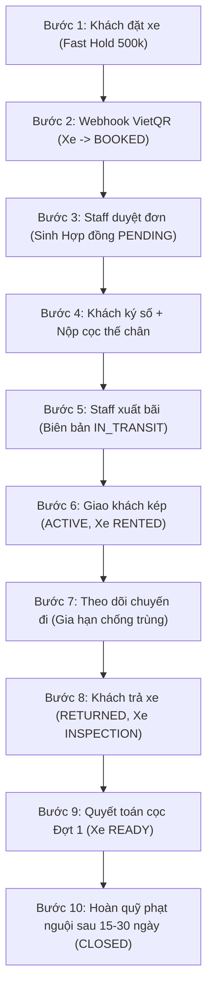

# CẨM NANG VẬN HÀNH & MA TRẬN PHÂN QUYỀN 3 ROLE VELORA (V2.0)

> **Dành cho:** Toàn bộ đội ngũ Vận hành (Staff), Quản lý Vận hành (Manager) và Quản trị viên (Admin).  
> **Hệ thống:** Nền tảng Quản lý & Cho thuê Xe Tự lái Cao cấp VELORA.  
> **Phiên bản:** Clean Workflow 2.0.  

---

## 1. MA TRẬN PHÂN QUYỀN 3 ROLE BACKOFFICE

Hệ thống VELORA thiết lập phân quyền chặt chẽ trên cả giao diện Web (`CarRental.Web`) và cổng API (`CarRental.API`) thông qua 3 Policy: `Operations`, `Management`, và `AdminOnly`.

| Nghiệp vụ / Tính năng | Nhân viên (`STAFF`) | Quản lý (`MANAGER`) | Quản trị viên (`ADMIN`) | Ghi chú bảo mật & Quyền hạn |
| :--- | :---: | :---: | :---: | :--- |
| **Xem Dashboard Vận hành** | Có (Lối tắt điều phối) | Có (Đầy đủ) | Có (Đầy đủ) | `STAFF`: Ẩn hoàn toàn doanh thu & biểu đồ tài chính. |
| **Xem Doanh thu & Chỉ số Tài chính** | **BỊ KHÓA (null)** | **CÓ** | **CÓ** | Bảo vệ dữ liệu tài chính nhạy cảm của doanh nghiệp. |
| **Giám sát Cảnh báo ODO & Trung chuyển** | Ẩn | **CÓ** | **CÓ** | Xem danh sách xe có Soft Flag lệch ODO hoặc sự cố lúc giao. |
| **Duyệt / Từ chối Đơn thuê xe** | **CÓ** | **CÓ** | **CÓ** | Thao tác điều phối hằng ngày. |
| **Lập Biên bản Bàn giao & Nghiệm thu trả** | **CÓ** | **CÓ** | **CÓ** | Tạo biên bản xuất bãi `IN_TRANSIT` và hoàn tất `COMPLETED`. |
| **Báo cáo Sự cố Xe** | **CÓ** | **CÓ** | **CÓ** | Ghi nhận sự cố giao xe, cứu hộ, va quẹt. |
| **Xem / Lập dự thảo Quyết toán (Preview)** | **CÓ** | **CÓ** | **CÓ** | Staff chạy preview và tạo bản ghi quyết toán. |
| **Phê duyệt Hoàn cọc Đợt 1 (`confirm-refund`)** | **BỊ KHÓA (403)** | **CÓ** | **CÓ** | Thẩm quyền chi tiền cọc thuộc về Quản lý. |
| **Hoàn quỹ Phạt nguội Đợt 2 (sau 15–30 ngày)** | **BỊ KHÓA (403)** | **CÓ** | **CÓ** | Thẩm quyền tất toán quỹ phạt nguội 2.000.000đ. |
| **Giải quyết Khiếu nại (`resolve-dispute`)** | **BỊ KHÓA (403)** | **CÓ** | **CÓ** | Xử lý các khiếu nại cọc từ khách hàng. |
| **Phê duyệt / Từ chối KYC Khách hàng** | Xem danh sách | **Duyệt / Từ chối** | **Duyệt / Từ chối** | Xác minh CCCD và Giấy phép lái xe. |
| **Khóa / Mở khóa Tài khoản Khách hàng** | Ẩn | **CÓ** | **CÓ** | Khóa tài khoản vi phạm; Middleware chặn tức thì JWT cũ. |
| **Quản lý Đội xe (Thêm mới, Cập nhật)** | Chỉ xem danh sách | **Thêm / Sửa xe** | **Thêm / Sửa xe** | Quản lý đội xe hoạt động. |
| **Xóa Xe (`DELETE /api/vehicles/{id}`)** | **BỊ KHÓA (403)** | **BỊ KHÓA (403)** | **CÓ** | Chỉ ADMIN tối cao mới có quyền xóa tài sản xe. |
| **Cấu hình Bảng phí Bồi thường (Sơ đồ 2D)** | Chỉ xem | Chỉ xem | **Chỉnh sửa** | Biểu phí các bộ phận trên xe (`CompensationPolicies`). |
| **Cấu hình Mẫu Hợp đồng Điện tử** | Chỉ xem | Chỉ xem | **Chỉnh sửa** | Điều khoản pháp lý và mẫu hợp đồng thuê xe. |
| **Cấu hình Tham số Hệ thống (`SystemSettings`)** | **BỊ KHÓA (403)** | **BỊ KHÓA (403)** | **CÓ** | Dung sai nhiên liệu, hạn mức ODO, quỹ phạt nguội... |
| **Quản lý Nhân sự & Phân quyền Backoffice** | **BỊ KHÓA (403)** | **BỊ KHÓA (403)** | **CÓ** | Tạo tài khoản, đổi vai trò Staff/Manager/Admin. |

---

## 2. QUY TRÌNH VẬN HÀNH CHUẨN 10 BƯỚC KHÉP KÍN

### Bước 1 & 2: Đặt xe & Xác nhận Giữ chỗ Tự động
1. Khách hàng chọn xe, thời gian, địa điểm và bấm **Đặt xe (Fast Hold)**.
2. Hệ thống tạo giao dịch `HOLD_DEPOSIT` (500.000đ). Cổng VietQR sinh mã QR động kèm nội dung `VELORA COC <MãĐơn>`.
3. Khi khách chuyển khoản thành công, Webhook VietQR xác thực chữ ký HMAC-SHA256:
   - Trạng thái đơn: chuyển `HOLD_CONFIRMED`.
   - Trạng thái xe: chuyển `BOOKED` (khóa lịch xe tự động).
   - Cơ chế Idempotent: Giao dịch trùng `transaction_code` được xử lý an toàn không cộng dồn.

### Bước 3 & 4: Duyệt Đơn, Ký Hợp Đồng & Nộp Cọc Thế Chân
1. Nhân viên (`STAFF`) kiểm tra hồ sơ KYC của khách $\rightarrow$ Bấm **Phê duyệt đơn**.
   - Trạng thái đơn: `APPROVED`.
   - Hệ thống tự sinh Hợp đồng điện tử: `PENDING_SIGNATURE`.
2. Khách hàng đọc điều khoản và thực hiện **Ký số điện tử** trên giao diện:
   - Trạng thái hợp đồng: `SIGNED`.
3. Khách hàng thanh toán **Cọc thế chân** (`COLLATERAL`, đã tự động khấu trừ 500k tiền giữ chỗ):
   - Trạng thái hợp đồng: `DEPOSIT_PAID`.
   - Trạng thái đơn: `CONFIRMED`.
   - *(Lưu ý: Hệ thống chặn tuyệt đối việc xác nhận cọc thế chân nếu khách chưa ký hợp đồng).*

### Bước 5 & 6: Xuất Bãi & Bàn Giao Kép Tận Nơi
- **Trường hợp Giao xe tận nơi:**
  1. *Tại bãi (Staff xuất bãi):* Tạo biên bản ở trạng thái `IN_TRANSIT`, chụp ảnh taplo ghi nhận `dispatch_odo`, `dispatch_fuel_level` (100%), xác nhận sơ đồ vết xước cũ `PRE_EXISTING`.
  2. *Tại điểm hẹn với khách (Giao khách):* Bấm **Hoàn tất bàn giao**:
     - Nhập `handover_odo` và `handover_fuel_level`.
     - Chụp ảnh taplo bàn giao (`handover_dash_photo_url`).
     - Cả Nhân viên và Khách hàng ký xác nhận kép trên thiết bị.
  3. *Đồng bộ hệ thống:* Đơn `ACTIVE`, Hợp đồng `ACTIVE`, Xe `RENTED`.

- **Trường hợp Khách nhận xe tại bãi:** Bỏ qua bước trung chuyển, thực hiện bàn giao trực tiếp `COMPLETED`.

### Bước 7: Quản lý Chuyến Đi & Gia Hạn Thuê Xe
1. Nếu khách hàng có nhu cầu gia hạn, gửi yêu cầu qua giao diện khách hàng.
2. Nhân viên/Quản lý duyệt gia hạn:
   - Hệ thống tự động kiểm tra xem khung giờ gia hạn có bị đè vào lịch của khách hàng tiếp theo hay không.
   - Nếu bị trùng: Hệ thống chặn và trả lỗi **HTTP 409 Conflict** ("Xe đã có khách hàng khác đặt trong khoảng thời gian này").

### Bước 8: Nghiệm Thu Nhận Lại Xe & Đưa Xe Về Bãi
1. *Tại điểm hẹn trả xe (Khách bàn giao):*
   - Ghi nhận `customer_return_odo`, mức nhiên liệu `customer_return_fuel_level`.
   - Chụp ảnh taplo lúc khách trả xe (`return_dash_photo_url`).
   - Kiểm tra sơ đồ xe 2D: Toàn bộ vết cũ (`PRE_EXISTING`, `TRANSIT_DELIVERY`) đã bị khóa; nếu phát sinh vết trầy mới do khách, chấm marker mang nhãn `CUSTOMER_RENTAL` và nhập đơn giá bồi thường.
   - Nhân viên và Khách hàng ký nghiệm thu kép.
2. *Đưa xe về bãi:* Nhân viên nhập `yard_checkin_odo` và `yard_checkin_fuel_level`.
3. *Đồng bộ hệ thống:* Đơn `RETURNED`, Xe `INSPECTION` (Chờ vệ sinh & kiểm tra kỹ thuật).

### Bước 9: Quyết Toán Cọc Đợt 1
1. Nhân viên bấm **Lập quyết toán (Preview)**:
   - Hệ thống tự động tính quãng đường khách sử dụng: `customer_return_odo - handover_odo` (loại bỏ hoàn toàn km trung chuyển).
   - Áp dụng dung sai nhiên liệu 3%: Nếu thiếu hụt $\le 3\%$, hệ thống miễn thu phụ phí nhiên liệu.
   - Chỉ tính tiền phạt vết trầy xước `CUSTOMER_RENTAL` (loại trừ vết phát sinh lúc Staff giao xe).
   - Tự động tách giữ **2.000.000đ** vào Quỹ phạt nguội 15–30 ngày.
2. Nhân viên lưu bảng kê quyết toán. Toàn bộ biên bản bàn giao và nhận xe sẽ được **Khóa cứng (Locked)** để bảo toàn hồ sơ kế toán.
3. Quản lý (`MANAGER`) kiểm tra số tài khoản ngân hàng của khách và bấm **Xác nhận hoàn cọc Đợt 1**:
   - Trạng thái đơn: `SETTLED`.
   - Trạng thái phiếu quyết toán: `PARTIALLY_SETTLED`.
   - Trạng thái xe: `READY` (Sẵn sàng phục vụ khách hàng tiếp theo).

### Bước 10: Đối Soát Vi Phạm & Hoàn Quỹ Phạt Nguội Đợt 2 (Sau 15–30 Ngày)
1. Hằng ngày lúc 08:00 sáng, hệ thống tự động quét và gửi danh sách các đơn đã đến hạn đối soát phạt nguội.
2. Quản lý tra cứu dữ liệu vi phạm trên hệ thống Cục CSGT:
   - *Không có vi phạm:* Hoàn trả 100% (2.000.000đ) về tài khoản của khách.
   - *Có biên bản vi phạm:* Nhập số tiền phạt thực tế bị trừ và đính kèm biên bản.
3. Quản lý bấm **Xác nhận hoàn quỹ phạt nguội**:
   - Quyết toán: `CLOSED`.
   - Hợp đồng: `COMPLETED`.
   - Đơn thuê: `COMPLETED`.
   - **Đặc biệt (Hotfix bảo đảm):** Trạng thái của xe được giữ nguyên độc lập. Nếu xe lúc đó đang được khách khác đặt trước (`BOOKED`) hoặc đang trên đường (`RENTED`), hệ thống tuyệt đối **không ghi đè về `READY`**.
   - Cơ chế Idempotent: Mỗi quyết toán chỉ được hoàn quỹ phạt nguội đúng 1 lần duy nhất.

---

## 3. CƠ CHẾ HÓA GIẢI 3 BẪY NGHIỆP VỤ THỰC TẾ

### Bẫy 1: Hao hụt Nhiên liệu / Pin & Ngưỡng Dung Sai (Fuel Tolerance)
- **Vấn đề:** Khách nhận xe 95% pin/xăng, khi trả còn 93% thường bị trừ cọc oan uổng gây tranh chấp, hoặc Staff giao xe đi xa làm hao xăng trước khi gặp khách.
- **Giải pháp VELORA:**
  1. Tách đôi 4 mốc: `dispatch_fuel_level` & `handover_fuel_level` (chiều đi) và `customer_return_fuel_level` & `yard_checkin_fuel_level` (chiều về).
  2. Bảng kê chỉ so sánh mức chênh lệch giữa lúc **Giao khách** và lúc **Khách trả**.
  3. Cài đặt tham số `fuel_tolerance_percent = 3.0%` (hoặc 0.5 vạch xăng): Nếu mức hao hụt $\le 3\%$, hệ thống ghi nhận `fuelFee = 0` và hiển thị nhãn xanh *"Miễn phụ phí (trong ngưỡng dung sai)"*.

### Bẫy 2: Trách nhiệm Trầy Xước 4 Tầng Marker trên Sơ đồ 2D
- **Vấn đề:** Khách bị phạt oan những vết xước phát sinh trong lúc Staff lái xe giao tới nhà khách.
- **Giải pháp VELORA:**
  - **Xám (`PRE_EXISTING`):** Vết xước cũ kế thừa từ các chuyến thuê trước $\rightarrow$ Khóa, chỉ đọc.
  - **Cam (`TRANSIT_DELIVERY`):** Vết xước phát sinh lúc Staff lái xe giao cho khách $\rightarrow$ Tự động tạo bản ghi Sự cố nội bộ (`INTERNAL_TRANSIT`, chịu trách nhiệm: `STAFF`, chi phí khách: `0đ`). Khi trả xe, vết này bị khóa và tuyệt đối không phạt tiền khách.
  - **Đỏ (`CUSTOMER_RENTAL`):** Vết xước mới do khách hàng gây ra trong quá trình sử dụng $\rightarrow$ Được chuyển sang bảng quyết toán để trừ cọc.
  - **Vàng/Tím (`TRANSIT_RETURN`):** Vết xước phát sinh khi Staff lái xe từ nhà khách về bãi $\rightarrow$ Trách nhiệm nội bộ của đội giao nhận.

### Bẫy 3: Audit Bất thường ODO 2 Cấp Độ 2 Chiều
- **Công thức định mức:** `max_allowed_km = (estimated_delivery_distance_km * 1.3) + 5` (hoặc mặc định 50 km).
- **Cấp 1 — Khóa cứng (Hard Block, HTTP 400):**
  - Chặn lưu ngay lập tức nếu `handover_odo < dispatch_odo` (lùi công-tơ-mét).
  - Chặn lưu nếu `transit_km > 300 km` hoặc gấp 3 lần định mức (chống gõ nhầm số ODO).
- **Cấp 2 — Cảnh báo mềm (Soft Flag):**
  - Nếu `transit_km > max_allowed_km` (ví dụ kẹt xe phải đi đường vòng): Hệ thống hiển thị cảnh báo vàng, bắt buộc Staff phải nhập lý do giải trình (`transit_anomaly_note`), lưu `has_transit_anomaly = true` nhưng **vẫn cho phép hoàn tất giao xe bình thường** để không làm lỡ việc của khách hàng.
  - Cảnh báo này sẽ được đẩy trực tiếp lên Dashboard để Manager hậu kiểm.
  - Cơ chế áp dụng đối xứng cho chiều xe về bãi (`return_anomaly_note`).

---

## 4. HƯỚNG DẪN THAO TÁC NHANH THEO VAI TRÒ

### Dành cho Nhân viên Vận hành (`STAFF`)
1. Đăng nhập hệ thống $\rightarrow$ Màn hình mặc định là **Bảng Điều Phối Vận Hành** (tập trung vào 4 chỉ số xe cần giao, cần nhận, sự cố và duyệt đơn).
2. Khi giao xe: Luôn mở **HandoverModal**, nhập đúng ODO và chụp ảnh taplo rõ nét. Nếu bị báo vượt ODO, điền lý do thực tế (kẹt xe, đường cấm) vào ô giải trình.
3. Khi nhận xe: Đảm bảo khách cùng kiểm tra sơ đồ 2D và chỉ chấm thêm các vết xước thực sự mới do chuyến đi phát sinh.

### Dành cho Quản lý Vận hành (`MANAGER`)
1. Theo dõi mục **Cảnh báo Hậu kiểm Trung chuyển (Transit Anomalies)** trên Dashboard để phát hiện các nhân viên thường xuyên đi lệch ODO hoặc làm trầy xe trong lúc giao nhận.
2. Kiểm tra kỹ hồ sơ định danh (CCCD/GPLX) trước khi duyệt KYC khách hàng.
3. Chỉ bấm **Xác nhận hoàn cọc Đợt 1** khi đã có ủy nhiệm chi hoặc chuyển khoản VietQR thành công.
4. Quản lý danh sách hoàn phạt nguội Đợt 2 sau 15–30 ngày: Tra cứu kỹ cổng CSGT trước khi giải ngân hoàn tất đơn.

### Dành cho Quản trị viên (`ADMIN`)
1. Định kỳ rà soát các tham số vận hành tại **Cấu hình Hệ thống** (`/admin/settings`): Dung sai nhiên liệu, định mức ODO, quỹ phạt nguội.
2. Quản lý danh mục tài khoản nhân sự và điều chỉnh phân quyền đúng vai trò `STAFF` hoặc `MANAGER`.
3. Quản lý biểu phí bồi thường và mẫu hợp đồng điện tử theo quy định pháp lý mới nhất.

---
*Tài liệu ban hành chính thức cùng đợt nghiệm thu Pha 5 — VELORA Clean Workflow V2.0.*
