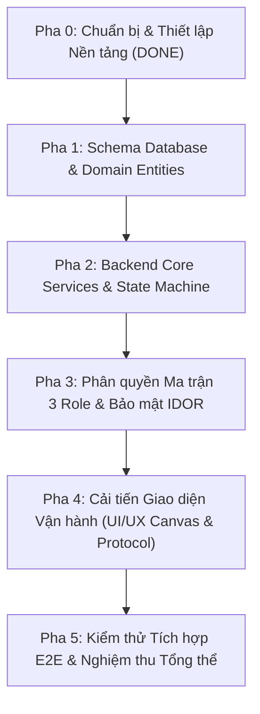

# KẾ HOẠCH TỔNG THỂ REFACTOR HỆ THỐNG VELORA (V2.0 CLEAN WORKFLOW)

> **Tài liệu kiểm soát tiến độ & kiến trúc refactor**  
> **Nhánh Git:** `refactor/velora-clean-workflow`  
> **Phiên bản tài liệu:** 2.0 (Finalized Phase 0)  
> **Ngày khởi tạo:** 20/11/2026  
> **Quy chuẩn tuân thủ:** `docs/REFACTOR_RULES.md`, `docs/VELORA_SPEC.md`, `PROJECT_HANDOVER_V2.md`

---

## 1. MỤC TIÊU & TẦM NHÌN KIẾN TRÚC

Nâng cấp nền tảng VELORA từ phiên bản 1.0 (Production-Ready) lên phiên bản 2.0 (Clean Workflow Architecture) với 4 trụ cột cốt lõi:
1. **Khép kín 100% Quy trình 10 bước nghiệp vụ** theo đặc tả `docs/VELORA_SPEC.md` từ lúc đặt xe, duyệt hồ sơ, bàn giao kép, nghiệm thu thu hồi, quyết toán cọc và hoàn quỹ phạt nguội sau 15–30 ngày.
2. **Hóa giải triệt để 3 bẫy nghiệp vụ thực tế**:
   - **Bẫy hao hụt nhiên liệu / pin:** Tách đôi mốc Xuất/Nhập bãi (`dispatch_fuel_level`, `yard_checkin_fuel_level`) và mốc Giao/Nhận khách (`handover_fuel_level`, `customer_return_fuel_level`). Đo theo % cho xe điện (EV) và thang 8 vạch (12.5%/vạch) cho xe xăng/dầu. Áp dụng ngưỡng dung sai `FuelTolerancePercent` (mặc định 3% EV hoặc 0.5 vạch xăng) trong `SettlementService` để tránh phạt oan khách.
   - **Bẫy trách nhiệm trầy xước trên sơ đồ 2D:** Tách biệt 3 sơ đồ JSON độc lập (`dispatch_damage_map`, `handover_damage_map`, `return_damage_map`). Cơ chế diff marker phân tầng: `PRE_EXISTING` $\rightarrow$ `TRANSIT_DELIVERY` $\rightarrow$ `CUSTOMER_RENTAL` $\rightarrow$ `TRANSIT_RETURN`. Vết xước phát sinh trong hành trình Staff giao xe tự động tạo bản ghi `incident_reports` nội bộ (`responsible_party = STAFF`, `customer_cost = 0`), tuyệt đối không quy trách nhiệm cho khách hàng.
   - **Bẫy cảnh báo bất thường ODO (Audit nội bộ 2 cấp độ):**
     - *Hard Block (Cấp 1):* Chặn lưu (HTTP 400) nếu `handover_odo < dispatch_odo` hoặc quãng đường trung chuyển `transit_km > max_allowed_km * 3` (hoặc > 300 km nội thành) để triệt tiêu lỗi gõ nhầm chữ số.
     - *Soft Flag (Cấp 2):* Nếu `transit_km > max_allowed_km` (với `max_allowed_km = estimated_delivery_distance_km * 1.3 + 5` hoặc mặc định 50 km) nhưng chưa vượt ngưỡng Hard Block: vẫn cho phép bàn giao xe và ký hợp đồng bình thường, nhưng bắt buộc nhập lý do giải trình `transit_anomaly_note`, gán `has_transit_anomaly = true` và đẩy cảnh báo lên Dashboard cho Manager. Áp dụng đối xứng cho chiều xe về bãi.
3. **Đồng bộ tuyệt đối State Machine** giữa 3 thực thể: `RentalRequest`, `RentalContract`, và `Car`:
   - `RentalRequest`: `PENDING`, `PENDING_HOLD_PAYMENT`, `HOLD_CONFIRMED`, `APPROVED`, `CONFIRMED`, `ACTIVE`, `RETURNED`, `SETTLED`, `COMPLETED`, `CANCELLED`, `REJECTED`.
   - `RentalContract`: `PENDING_SIGNATURE`, `SIGNED`, `DEPOSIT_PAID`, `ACTIVE`, `COMPLETED`, `DISPUTED`, `VOID`, `CANCELLED`.
   - `Car`: `READY`, `BOOKED`, `RENTED`, `INSPECTION`, `MAINTENANCE`, `REPAIR`, `INACTIVE`.
4. **Phân quyền Ma trận 3 Role Backoffice chuẩn hóa**:
   - `STAFF` (Nhân viên vận hành): Thao tác nghiệp vụ hằng ngày (duyệt đơn, bàn giao, nhận xe, báo sự cố, lập dự toán nháp preview). Ẩn hoàn toàn thẻ Doanh thu & biểu đồ tài chính, ẩn Cấu hình chính sách, ẩn Quản trị nhân sự/hệ thống.
   - `MANAGER` (Quản lý vận hành): Giám sát đội xe, xem đầy đủ doanh thu, hậu kiểm cảnh báo lệch ODO & vết xước trung chuyển, duyệt/từ chối KYC, xử lý sự cố & khiếu nại (`resolve-dispute`), phê duyệt hoàn cọc và hoàn quỹ phạt nguội 2tr.
   - `ADMIN` (Chủ hệ thống): Toàn quyền tối cao (xóa xe, sửa biểu phí bồi thường, sửa mẫu hợp đồng, phân quyền nhân sự Staff/Manager, cấu hình hệ thống `/admin/settings`, Audit Logs).

---

## 2. NGUYÊN TẮC BẮT BUỘC TRƯỚC VÀ TRONG KHI SỬA CODE (THEO REFACTOR_RULES)

1. **Tuân thủ đặc tả nghiệp vụ:** Mọi thay đổi logic code phải đối chiếu trực tiếp với `docs/VELORA_SPEC.md`. Không tự ý suy diễn hoặc thêm bớt các bước ngoài luồng chuẩn.
2. **Theo dõi tiến độ theo từng Pha:** Cập nhật trạng thái từng đầu việc trong `docs/REFACTOR_PLAN.md` và `docs/PROGRESS.md`. Không nhảy cóc khi chưa hoàn thành tiêu chí nghiệm thu (Acceptance Criteria) của pha trước.
3. **Bảo toàn phạm vi & Dữ liệu:**
   - Không tự ý refactor CSS/giao diện ngoài phạm vi yêu cầu.
   - Không tự ý đổi tên file hoặc cấu trúc thư mục không liên quan.
   - Tuyệt đối không xóa dữ liệu hiện có trên cơ sở dữ liệu Supabase. Mọi migration chỉ thêm bảng, thêm cột (nullable hoặc có default value), bảo toàn dữ liệu cũ.
4. **Kiểm thử & Biên dịch bắt buộc:**
   - Luôn chạy `dotnet build` (Backend) và `npm run build` (Frontend) xác nhận **0 errors, 0 warnings** trước khi đánh dấu hoàn thành bất kỳ tác vụ nào.

---

## 3. RÀ SOÁT TÀI NGUYÊN CŨ & TÁI SỬ DỤNG HẠ TẦNG HIỆN HỮU (PROJECT_HANDOVER_V2)

Để tránh việc viết trùng lặp hoặc tạo các class cạnh tranh với luồng v1.0, dự án cam kết tái sử dụng 100% các thành phần đã hoàn thiện:

| Thành phần hiện hữu | Vị trí file trong dự án | Chiến lược kế thừa & Tái sử dụng |
| :--- | :--- | :--- |
| **FastHoldExpirationWorker** | `CarRental.API/Workers/FastHoldExpirationWorker.cs` | **Kế thừa 100%:** Tiếp tục chạy chu kỳ 5 phút quét đơn `FAST_HOLD` quá 4 tiếng chưa thanh toán cọc 500k hoặc chưa nộp CCCD/GPLX để hủy đơn và trả xe về `READY`. |
| **DailyOperationalAlertsWorker** | `CarRental.API/Workers/DailyOperationalAlertsWorker.cs` | **Kế thừa & Mở rộng:** Tiếp tục quét hàng ngày lúc 08:00 nhắc lịch hoàn cọc phạt nguội (15–30 ngày) và cảnh báo hạn đăng kiểm/bảo hiểm xe. |
| **VietQR Webhook & Idempotency** | `CarRental.API/Controllers/PaymentsController.cs`, `PaymentService.cs` | **Tái sử dụng:** Giữ nguyên cơ chế xác thực HMAC-SHA256 và chống ghi nhận trùng giao dịch (`transaction_code`) cho luồng 500k giữ chỗ và cọc thế chân. |
| **Exclusion Constraint chống trùng lịch** | PostgreSQL Supabase extension `btree_gist` trên `rental_requests` | **Tái sử dụng & Bổ sung:** Tận dụng triệt để cho bước 1 (tạo đơn) và mở rộng cho bước 7 (kiểm tra không chồng lấn lịch khi duyệt gia hạn `RentalExtension`). |
| **UserActiveStatusMiddleware** | `CarRental.API/Middleware/UserActiveStatusMiddleware.cs` | **Tái sử dụng:** Đảm bảo mọi request từ tài khoản có `is_active = false` đều bị chặn ngay lập tức tại cổng HTTP pipeline. |
| **HybridCache & IStorageService** | `CarRental.API/Common`, `Program.cs` | **Tái sử dụng:** Dùng cho upload ảnh taplo/vết xước lên Supabase Storage và cache cấu hình hệ thống. |

### Chiến lược xử lý cột cũ (Legacy Columns Migration Strategy)
Trong cơ sở dữ liệu hiện tại, các bảng bàn giao đang sử dụng các cột đơn lẻ:
- `handover_protocols`: `start_km`, `fuel_level`, `damage_points_json`
- `return_protocols`: `start_km`, `end_km`, `fuel_level`, `initial_fuel_level`, `damage_points_json`

**Chiến lược dứt điểm không để 2 luồng chạy song song:**
1. **Migration Backfill:** Trong file migration SQL của Pha 1, thực hiện sao chép toàn bộ dữ liệu lịch sử từ cột cũ sang các cột mới chuẩn hóa:
   ```sql
   UPDATE handover_protocols SET
       handover_odo = COALESCE(handover_odo, start_km, 0),
       dispatch_odo = COALESCE(dispatch_odo, start_km, 0),
       handover_fuel_level = COALESCE(handover_fuel_level, fuel_level, 100),
       dispatch_fuel_level = COALESCE(dispatch_fuel_level, fuel_level, 100),
       handover_damage_map = COALESCE(handover_damage_map, damage_points_json),
       dispatch_damage_map = COALESCE(dispatch_damage_map, damage_points_json),
       status = COALESCE(status, 'COMPLETED')
   WHERE handover_odo IS NULL OR handover_odo = 0;

   UPDATE return_protocols SET
       customer_return_odo = COALESCE(customer_return_odo, end_km, 0),
       yard_checkin_odo = COALESCE(yard_checkin_odo, end_km, 0),
       customer_return_fuel_level = COALESCE(customer_return_fuel_level, fuel_level, 100),
       yard_checkin_fuel_level = COALESCE(yard_checkin_fuel_level, fuel_level, 100),
       return_damage_map = COALESCE(return_damage_map, damage_points_json)
   WHERE customer_return_odo IS NULL OR customer_return_odo = 0;
   ```
2. **Chuyển dịch Service (Backend Switching):** Toàn bộ service (`HandoverProtocolService.cs`, `ReturnProtocolService.cs`, `RentalSettlementService.cs`) chuyển 100% sang đọc và ghi trên các cột mới. Cột cũ giữ nguyên trong database để đảm bảo an toàn dữ liệu lịch sử, Entity giữ thuộc tính tương thích nếu cần.

### Danh mục File Thật trên Frontend (`CarRental.Web`)
Tránh dùng tên file phỏng đoán, dự án rà soát và chốt chính xác các file mã nguồn liên quan trên Web:
- **Trang Dashboard & Quản trị:**
  - `src/layouts/AdminLayout.jsx` (Sidebar điều hướng, nhóm menu)
  - `src/pages/Dashboard/DashboardPage.jsx` (Dashboard chỉ số & doanh thu)
  - `src/pages/RentalRequests/RentalRequestsPage.jsx` (Duyệt đơn & kiểm tra KYC)
  - `src/pages/Handovers/HandoversPage.jsx` (Quản lý biên bản bàn giao)
  - `src/pages/Returns/ReturnsPage.jsx` (Quản lý biên bản nhận xe)
  - `src/pages/Settings/SystemSettingsPage.jsx` (Cấu hình tham số hệ thống)
- **Modal Vận hành & Sơ đồ 2D:**
  - `src/components/handover/HandoverModal.jsx` (Modal tạo/ký bàn giao xe)
  - `src/components/operations/CustomerHandoverModal.jsx` (Khách ký xác nhận bàn giao)
  - `src/components/operations/ReturnProtocolModal.jsx` (Modal thu hồi xe & ghi nhận ODO/xăng)
  - `src/components/operations/VehicleDamageMap.jsx` (Canvas vẽ vết xước 2D xe)
  - `src/components/operations/SettlementModal.jsx` (Modal tính toán quyết toán cọc)
  - `src/components/operations/CustomerSettlementReceiptModal.jsx` (Biên nhận quyết toán khách xem)
  - `src/components/operations/IncidentModal.jsx` (Modal tiếp nhận sự cố)
  - `src/components/operations/ExtensionModal.jsx` (Modal duyệt gia hạn đơn)

---

## 4. LỘ TRÌNH CHI TIẾT TỪNG PHA (PHASE ROADMAP)



---

### PHA 0: CHUẨN BỊ, KHẢO SÁT & THIẾT LẬP NỀN TẢNG (BASELINE SETUP) — [HOÀN THÀNH]
- **Mục tiêu:** Xác lập baseline biên dịch sạch 100%, khảo sát chính xác tên file thật, chốt chiến lược migration không gây gián đoạn.
- **Nội dung công việc:**
  1. [x] Đọc và đối chiếu toàn bộ `docs/REFACTOR_RULES.md`, `docs/VELORA_SPEC.md`, và `PROJECT_HANDOVER_V2.md`.
  2. [x] Xác minh trạng thái git trên nhánh `refactor/velora-clean-workflow`.
  3. [x] **Xác minh Baseline Biên dịch:**
     - Backend (`CarRental.API`): Chạy `dotnet build` đạt kết quả sạch: **0 Warning(s), 0 Error(s)**.
     - Frontend (`CarRental.Web`): Chạy `npm run build` Vite v8.3.0 đạt kết quả sạch: **0 errors**.
  4. [x] Khảo sát danh mục file thật trong `CarRental.Web/src` (chốt chính xác các file `HandoverModal.jsx`, `ReturnProtocolModal.jsx`, `VehicleDamageMap.jsx`, `SettlementModal.jsx`...).
  5. [x] Chốt chiến lược backfill dữ liệu từ cột cũ (`start_km`, `fuel_level`...) sang cột mới, cam kết không chạy 2 luồng song song.
  6. [x] Rà soát và liệt kê các thành phần hạ tầng v1.0 được kế thừa (Workers, Webhook VietQR HMAC, Exclusion Constraint, UserActiveStatusMiddleware).
  7. [x] Ban hành `docs/REFACTOR_PLAN.md` và `docs/PROGRESS.md`.
- **Tiêu chí nghiệm thu (Acceptance Criteria):**
  - Kế hoạch hoàn thiện, giải quyết triệt để 4 điểm phản hồi.
  - Baseline Backend và Frontend đạt 0 errors, 0 warnings.
  - Đánh dấu hoàn thành Pha 0 trong `docs/PROGRESS.md` và commit git.

---

### PHA 1: CƠ SỞ DỮ LIỆU & DOMAIN ENTITIES (DATABASE SCHEMA UPGRADES) — [HOÀN THÀNH]
- **Mục tiêu:** Nâng cấp Domain Entities và cập nhật Schema PostgreSQL trên Supabase, bảo đảm tương thích và không mất dữ liệu lịch sử.
- **Nội dung công việc:**
  1. **Chuẩn hóa Enums (`CarRental.API/Entities/Enums.cs`):**
     - Bổ sung/chuẩn hóa `RentalRequestStatus`: `PENDING`, `PENDING_HOLD_PAYMENT`, `HOLD_CONFIRMED`, `APPROVED`, `CONFIRMED`, `ACTIVE`, `RETURNED`, `SETTLED`, `COMPLETED`, `CANCELLED`, `REJECTED`.
     - Chuẩn hóa `ContractStatus`: `PENDING_SIGNATURE`, `SIGNED`, `DEPOSIT_PAID`, `ACTIVE`, `COMPLETED`, `DISPUTED`, `VOID`, `CANCELLED`.
     - Thêm `HandoverStatus`: `IN_TRANSIT`, `COMPLETED`.
     - Thêm `DamageStage`: `PRE_EXISTING`, `TRANSIT_DELIVERY`, `CUSTOMER_RENTAL`, `TRANSIT_RETURN`.
     - Thêm `IncidentResponsibleParty`: `STAFF`, `CUSTOMER`, `THIRD_PARTY`, `FORCE_MAJEURE`.
     - Thêm `IncidentType`: `INTERNAL_TRANSIT`, `COLLISION`, `BREAKDOWN`, `WEATHER`, `THEFT_VANDALISM`.
  2. **Nâng cấp `HandoverProtocol.cs`:**
     - Thêm cột ODO: `dispatch_odo` (int, lúc xuất bãi), `handover_odo` (int, lúc gặp khách).
     - Thêm cột Nhiên liệu: `dispatch_fuel_level` (decimal, nullable), `handover_fuel_level` (decimal, required).
     - Thêm ảnh taplo: `handover_dash_photo_url` (string, nullable).
     - Thêm trường audit bất thường ODO: `has_transit_anomaly` (bool, default false), `transit_anomaly_note` (string, nullable).
     - Thêm trạng thái: `status` (string/enum: `IN_TRANSIT`, `COMPLETED`).
     - Tách biệt sơ đồ xước 2D: `dispatch_damage_map` (string JSON), `handover_damage_map` (string JSON).
  3. **Nâng cấp `ReturnProtocol.cs`:**
     - Thêm cột ODO: `customer_return_odo` (int, lúc thu xe khách), `yard_checkin_odo` (int, lúc xe về bãi).
     - Thêm cột Nhiên liệu: `customer_return_fuel_level` (decimal, required), `yard_checkin_fuel_level` (decimal, nullable).
     - Thêm ảnh taplo: `return_dash_photo_url` (string, nullable).
     - Thêm trường audit bất thường ODO chiều về: `has_return_anomaly` (bool, default false), `return_anomaly_note` (string, nullable).
     - Thêm sơ đồ xước 2D trả xe: `return_damage_map` (string JSON).
  4. **Nâng cấp `RentalRequest.cs`, `RentalContract.cs`, `RentalSettlement.cs`, `IncidentReport.cs`:**
     - `RentalRequest`: thêm `estimated_delivery_distance_km` (decimal, nullable).
     - `RentalSettlement`: đảm bảo trạng thái `PARTIALLY_SETTLED`, `CLOSED`, và trường `traffic_fine_hold_amount` (mặc định 2.000.000đ).
     - `IncidentReport`: thêm `incident_type`, `responsible_party`, `customer_cost`, `staff_cost`, `company_cost`.
  5. **Seed an toàn cấu hình hệ thống (`system_settings`):**
     - Insert an toàn các key nếu chưa có:
       * `FuelTolerancePercent`: `3.0` (dung sai 3% pin EV hoặc 0.5 vạch xăng)
       * `MaxDefaultTransitKm`: `50.0` (ngưỡng trung chuyển mặc định 50 km)
       * `TrafficFineHoldAmount`: `2000000` (quỹ cọc phạt nguội 2.000.000đ)
  6. **Script Migration & Backfill dữ liệu PostgreSQL:**
     - Viết migration script bằng lệnh `ALTER TABLE ... ADD COLUMN IF NOT EXISTS`.
     - Thực thi câu lệnh `UPDATE` backfill dữ liệu từ cột cũ sang cột mới.
     - Cập nhật cấu hình EF Core trong `CarRentalDbContext.cs`.
- **Tiêu chí nghiệm thu (Acceptance Criteria):**
  - Backend compile thành công: `dotnet build` đạt **0 errors, 0 warnings**.
  - Dữ liệu lịch sử trên Supabase được backfill đầy đủ sang các cột mới mà không bị mất mát hay gián đoạn.

---

### PHA 2: BACKEND CORE SERVICES & STATE MACHINE ENGINE — [HOÀN THÀNH]
- **Mục tiêu:** Cài đặt toàn bộ quy tắc nghiệp vụ, giải thuật tính toán 3 bẫy thực tế và kiểm soát chuyển đổi trạng thái đồng bộ giữa `RentalRequest`, `RentalContract` và `Car`.
- **Nội dung công việc:**
  1. [x] **Xử lý Bẫy 1 - Hao hụt nhiên liệu / pin (`SettlementService` & Protocol Services):**
     - Đọc cấu hình dung sai `FuelTolerancePercent` từ `system_settings`.
     - Tính phụ phí hao hụt xăng/pin chỉ dựa trên `deficit = handover_fuel_level - customer_return_fuel_level`.
     - Miễn trừ phụ phí nếu `deficit <= tolerance`.
     - Tự động ghi nhận `transit_fuel_drop = dispatch_fuel_level - handover_fuel_level`, nếu hao hụt bất thường (>15%) thì gắn cờ cảnh báo cho Manager.
  2. [x] **Xử lý Bẫy 2 - Sơ đồ 2D và Cơ chế Phân loại Marker (`HandoverProtocolService` & `ReturnProtocolService`):**
     - Khi xuất bãi (`IN_TRANSIT`): Kế thừa marker chưa sửa từ lần thuê trước vào `dispatch_damage_map` với stage `PRE_EXISTING`.
     - Khi bàn giao khách (`COMPLETED`): So sánh marker mới trong `handover_damage_map` so với `dispatch_damage_map` $\rightarrow$ Đánh dấu `TRANSIT_DELIVERY`. Trong cùng transaction, tự động tạo bản ghi `incident_reports` nội bộ (`incident_type = INTERNAL_TRANSIT`, `responsible_party = STAFF`, `customer_cost = 0`), không quy trách nhiệm cho khách.
     - Khi nhận lại xe (`ReturnProtocol`): Khóa toàn bộ marker từ lúc giao; chỉ marker mới phát sinh trong `return_damage_map` (`CUSTOMER_RENTAL`) mới chuyển sang `SettlementService` để tính khấu trừ theo `compensation_policies`.
  3. [x] **Xử lý Bẫy 3 - Audit ODO nội bộ 2 cấp độ (`HandoverProtocolService` & `ReturnProtocolService`):**
     - Tính `transit_km = handover_odo - dispatch_odo`.
     - Tính `max_allowed_km = (estimated_delivery_distance_km * 1.3) + 5` (hoặc lấy từ setting mặc định 50 km).
     - *Cấp 1 - Hard Block:* Nếu `handover_odo < dispatch_odo` hoặc `transit_km > max_allowed_km * 3` (hoặc > 300 km) $\rightarrow$ Trả lỗi HTTP 400 chặn lưu, bắt kiểm tra lại ảnh taplo.
     - *Cấp 2 - Soft Flag:* Nếu `transit_km > max_allowed_km` nhưng <= ngưỡng Hard Block $\rightarrow$ Cho phép giao xe và ký hợp đồng bình thường, nhưng bắt buộc nhập `transit_anomaly_note`, gán `has_transit_anomaly = true` và gửi thông báo cảnh báo về Dashboard của Manager.
     - Áp dụng logic đối xứng cho chiều xe về bãi trên `ReturnProtocolService`.
  4. [x] **Các ràng buộc chặt chẽ State Machine 10 bước:**
     - **Chặn chuyển `DEPOSIT_PAID` nếu chưa `SIGNED`:** Hợp đồng bắt buộc phải qua trạng thái `SIGNED` trước khi ghi nhận cọc thành công.
     - **Nhánh hủy đơn trước khi giao xe:** Nếu khách hủy đơn sau khi ký hoặc từ chối đơn, chuyển `RentalRequest -> CANCELLED`, `RentalContract -> VOID`, và giải phóng `Car -> READY`.
     - **Kiểm tra chống trùng lịch khi gia hạn (Bước 7):** Khi Staff duyệt gia hạn `RentalExtension`, bắt buộc kiểm tra `Exclusion Constraint` không trùng lịch đặt trước của xe trong khung giờ mở rộng mới, bắt lỗi `23P01` trả HTTP 409 Conflict.
     - **Khóa cứng sau khi quyết toán:** Sau khi `RentalSettlement` chuyển sang trạng thái `PARTIALLY_SETTLED`, `SETTLED` hoặc `CLOSED`, khóa cứng không cho phép chỉnh sửa ngược `HandoverProtocol` và `ReturnProtocol`.
     - **Quy trình hoàn quỹ phạt nguội (Bước 10):** Xác nhận hoàn 2.000.000đ sau 15–30 ngày bảo đảm tính `Idempotent` (chỉ bấm hoàn 1 lần duy nhất), cập nhật `RentalSettlement -> CLOSED`, `RentalContract -> COMPLETED`, `RentalRequest -> COMPLETED`.
  5. [x] **Sửa lỗi lệch số liệu Analytics Dashboard (`AnalyticsService` & `AdminLayout.jsx`):**
     - Chuẩn hóa điều kiện đếm xe hoạt động (`is_active = true && status != INACTIVE`), đồng bộ số lượng xe giữa Sidebar, thẻ trạng thái và thẻ xe sẵn sàng.
     - Sửa công thức tính tỷ lệ khai thác chính xác.
- **Tiêu chí nghiệm thu (Acceptance Criteria):**
  - `dotnet build` đạt 0 errors, 0 warnings.
  - Chặn đứng 100% các vi phạm State Machine và thực thi chuẩn xác các ràng buộc bổ sung.

---

### PHA 3: PHÂN QUYỀN MA TRẬN 3 ROLE (STAFF, MANAGER, ADMIN) & BẢO MẬT IDOR
- **Mục tiêu:** Tách bạch triệt để trách nhiệm vận hành, kiểm soát chéo, bảo mật thông tin tài chính và triệt tiêu lỗ hổng IDOR.
- **Nội dung công việc:**
  1. **Triệt tiêu lỗ hổng IDOR (Insecure Direct Object References):**
     - Trên các API nhạy cảm của khách hàng (`POST /api/contracts/{id}/sign`, `POST /api/rental-requests/{id}/cancel`, `POST /api/settlements/{id}/dispute`, `GET /api/rental-requests/my-requests`):
       - Tuyệt đối không tin cậy `userId` do client gửi lên trong Request Body/Query.
       - Trích xuất `UserId` trực tiếp từ Claim của JWT Token đã xác thực (`User.FindFirstValue(ClaimTypes.NameIdentifier)`).
       - Đối chiếu `contract.RentalRequest.UserId == currentUserId`. Nếu không khớp, trả ngay HTTP 403 Forbidden.
  2. **Chặn tài khoản bị khóa (`is_active = false`):**
     - Tăng cường `UserActiveStatusMiddleware` và kiểm tra ở tầng Service để đảm bảo người dùng bị khóa không thể thực hiện bất kỳ thao tác tạo đơn, ký hợp đồng hay thanh toán nào.
  3. **Backend Authorization Policies (`Program.cs` & Controllers):**
     - Cấu hình Policy chặt chẽ:
       * `Operations`: STAFF, MANAGER, ADMIN (duyệt đơn, bàn giao, thu xe, ghi nhận sự cố, tạo dự toán nháp preview).
       * `Management`: MANAGER, ADMIN (xem doanh thu, hậu kiểm ODO/xước, duyệt/từ chối KYC, khóa tài khoản, giải quyết khiếu nại `resolve-dispute`, xác nhận hoàn cọc và hoàn quỹ phạt nguội).
       * `AdminOnly`: ADMIN (toàn quyền, xóa xe, sửa biểu phí bồi thường, sửa mẫu hợp đồng, phân quyền nhân sự, cấu hình `/admin/settings`).
     - Gắn Policy lên Controllers:
       * `RentalSettlementsController`: Khóa `confirm-refund`, `confirm-traffic-fine-refund`, `resolve-dispute` chỉ cho `Management`.
       * `AnalyticsController`: Ẩn endpoint doanh thu đối với STAFF.
       * `PricingController`, `PoliciesController`, `SettingsController`: Khóa theo đúng ma trận.
  4. **Frontend UI Permission Enforcement (`AdminLayout.jsx` & Protected Routes):**
     - Ẩn hoàn toàn menu "CẤU HÌNH CHÍNH SÁCH" khi người dùng đăng nhập có role `STAFF`.
     - Thay thế số lượng xe cứng `Danh sách xe (27)` trên sidebar bằng số liệu đếm động từ API.
     - Cấu hình Route Guard chặn STAFF truy cập trực tiếp bằng URL vào `/admin/settings`, `/admin/pricing`, v.v.
  5. **Dashboard theo vai trò (`DashboardPage.jsx`):**
     - Với `STAFF`: Hiển thị "Bảng điều phối vận hành" (chỉ gồm: Đơn chờ duyệt, Xe sẵn sàng bàn giao, Xe trả trễ, Cảnh báo ODO/sự cố). Ẩn hoàn toàn thẻ "Tổng doanh thu" và biểu đồ doanh thu tài chính 6 tháng.
     - Với `MANAGER` & `ADMIN`: Hiển thị đầy đủ tổng quan tài chính, doanh thu, hiệu suất khai thác đội xe, và tab Hậu kiểm cảnh báo ODO trung chuyển.
- **Tiêu chí nghiệm thu (Acceptance Criteria):**
  - Thử nghiệm tài khoản STAFF: Không xem được doanh thu, không chỉnh được chính sách, không bấm được hoàn cọc.
  - Đảm bảo an toàn IDOR: Khách A không thể ký thay hay khiếu nại thay hợp đồng của Khách B.
  - Cả Backend và Frontend biên dịch sạch 0 errors, 0 warnings.

---

### PHA 4: CẢI TIẾN GIAO DIỆN VẬN HÀNH (FRONTEND UI/UX POLISH)
- **Mục tiêu:** Cung cấp giao diện trực quan cho nhân viên và khách hàng với các file thật đã xác minh.
- **Nội dung công việc:**
  1. **Nâng cấp Canvas Sơ đồ 2D (`VehicleDamageMap.jsx`):**
     - Hiển thị marker có màu sắc phân biệt theo `stage`:
       * Xám (`PRE_EXISTING`): Vết xước cũ (chỉ đọc, không cho sửa).
       * Cam (`TRANSIT_DELIVERY`): Vết xước phát sinh lúc trung chuyển (Staff giao xe).
       * Đỏ (`CUSTOMER_RENTAL`): Vết xước mới do khách làm lúc trả xe.
     - Tích hợp modal xem ảnh chụp chi tiết của từng vết xước.
  2. **Biểu mẫu Bàn giao xe (`HandoverModal.jsx`, `CustomerHandoverModal.jsx`):**
     - Nhập số ODO xuất bãi vs ODO bàn giao khách.
     - Chọn mức nhiên liệu thông minh theo `fuel_type`:
       * Xe điện: nhập số % pin (0–100%).
       * Xe xăng/dầu: chọn theo thang 8 vạch trực quan (12.5%/vạch).
     - Upload ảnh chụp đồng hồ Taplo bắt buộc (`handover_dash_photo_url`).
     - Cảnh báo trực quan khi ODO lệch ngưỡng: hiện ô bắt buộc nhập lý do giải trình (`transit_anomaly_note`).
  3. **Biểu mẫu Nghiệm thu Trả xe (`ReturnProtocolModal.jsx`):**
     - Nhập ODO khách trả vs ODO xe về bãi.
     - Nhập mức nhiên liệu thực tế lúc khách trả kèm ảnh taplo.
     - Đánh dấu vết xước mới trên sơ đồ 2D.
  4. **Giao diện Quyết toán & Quản lý Phạt nguội (`SettlementModal.jsx`, `CustomerSettlementReceiptModal.jsx`):**
     - Bảng kê chi tiết phụ phí có áp dụng dung sai nhiên liệu.
     - Tách bạch khoản hoàn cọc đợt 1 và khoản tạm giữ 2.000.000đ quỹ phạt nguội.
     - Nút xác nhận hoàn cọc đợt 2 (phạt nguội sau 15–30 ngày) chỉ hiển thị cho Manager/Admin kèm mã giao dịch VietQR.
- **Tiêu chí nghiệm thu (Acceptance Criteria):**
  - Giao diện mượt mà, thao tác nhạy trên tablet/mobile.
  - `npm run build` đạt 0 lỗi.

---

### PHA 5: KIỂM THỬ TÍCH HỢP TOÀN DIỆN (E2E VERIFICATION) & NGHIỆM THU
- **Mục tiêu:** Xác minh tính đúng đắn, nhất quán dữ liệu và độ an toàn của toàn bộ hệ thống sau khi refactor.
- **Nội dung công việc:**
  1. **Kịch bản kiểm thử tự động E2E (Integration Test Script):**
     - Giả lập trọn vẹn chu trình 10 bước nghiệp vụ:
       * Khách đặt xe Fast Hold $\rightarrow$ Nộp 500k qua webhook VietQR $\rightarrow$ Xe chuyển `BOOKED`.
       * Staff duyệt đơn $\rightarrow$ Sinh hợp đồng `PENDING_SIGNATURE`.
       * Khách ký số $\rightarrow$ Nộp cọc thế chân $\rightarrow$ Hợp đồng `DEPOSIT_PAID`.
       * Staff xuất bãi: ghi nhận ODO 1.000 km, 100% nhiên liệu, vết xước cũ A.
       * Staff giao xe khách: ODO 1.035 km (vượt ngưỡng $\rightarrow$ nhập giải trình kẹt xe), nhiên liệu 92%, ghi nhận vết xước quẹt nhẹ B lúc đi đường $\rightarrow$ Kiểm tra `incident_reports` nội bộ được tạo tự động cho Staff, không phạt tiền khách. Ký kép $\rightarrow$ Đơn `ACTIVE`, Xe `RENTED`.
       * Khách trả xe: ODO 1.350 km, nhiên liệu 75%, phát sinh 1 vết trầy mới C do khách $\rightarrow$ Đơn `RETURNED`, Xe `INSPECTION`.
       * Staff lập quyết toán: tính cước phát sinh (có dung sai xăng), trừ cọc, tạm giữ 2.000.000đ phạt nguội $\rightarrow$ Đơn `SETTLED`.
       * Giả lập sau 15 ngày: Manager kiểm tra không có lỗi vi phạm giao thông, bấm xác nhận hoàn nốt 2.000.000đ $\rightarrow$ Đơn và Hợp đồng đóng thành công (`COMPLETED`).
  2. **Kiểm tra tính toàn vẹn dữ liệu Supabase:**
     - Xác minh không có dữ liệu mồ côi hoặc sai lệch khóa ngoại.
     - Xác minh `Exclusion Constraint` hoạt động tốt cho cả đơn mới và đơn gia hạn.
  3. **Biên dịch và đóng gói hoàn tất:**
     - Chạy `dotnet build` xác nhận **0 errors, 0 warnings**.
     - Chạy `npm run build` xác nhận **0 errors**.
  4. **Cập nhật tài liệu bàn giao:**
     - Hoàn thiện `docs/PROGRESS.md` đạt 100%.
- **Tiêu chí nghiệm thu (Acceptance Criteria):**
  - Kịch bản kiểm thử E2E chạy thành công 100%.
  - Toàn bộ 10 bước quy trình và 3 bẫy nghiệp vụ hoạt động chính xác.
  - 0 lỗi biên dịch trên cả Backend và Frontend.

---

## 5. MA TRẬN THEO DÕI TIẾN ĐỘ TỔNG QUAN

| Pha | Tên công việc | Trạng thái | Phụ trách chính | Ghi chú |
| :---: | :--- | :---: | :---: | :--- |
| **Pha 0** | Chuẩn bị, Khảo sát & Thiết lập Nền tảng | **HOÀN THÀNH** | AI & User | Baseline sạch 0 errors/warnings, rà soát file thật |
| **Pha 1** | Schema Database & Domain Entities | **HOÀN THÀNH** | AI & User | Bổ sung cột mới, backfill dữ liệu, seed settings |
| **Pha 2** | Backend Core Services & State Machine | **HOÀN THÀNH** | AI & User | 10 bước + 3 bẫy nghiệp vụ + khóa settlement |
| **Pha 3** | Phân quyền Ma trận 3 Role & Bảo mật IDOR | Chờ thực hiện | AI & User | Staff/Manager/Admin, claim JWT, chặn user khóa |
| **Pha 4** | Cải tiến Giao diện Vận hành | Chờ thực hiện | AI & User | Sơ đồ 2D diff, form biên bản ODO/xăng |
| **Pha 5** | Kiểm thử Tích hợp E2E & Nghiệm thu | Chờ thực hiện | AI & User | Script test 10 bước khép kín |
